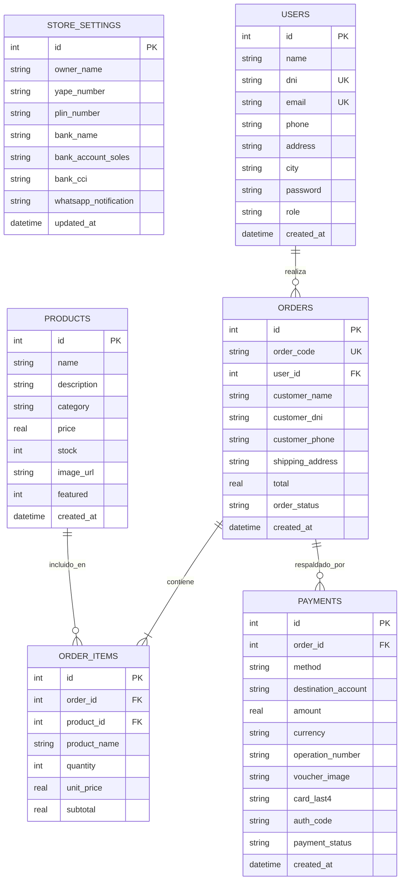

# Data Model: Módulo 001 - FitStore Pro

## 1. Diagrama Entidad-Relación (Mermaid)

---

## 2. Definición Detallada de Tablas

### 2.1. Tabla `store_settings`
Contiene la configuración del negocio y las cuentas de recaudación oficiales del propietario.
- `id` (INTEGER, Primary Key, Default 1).
- `owner_name` (TEXT, Not Null): Nombre completo del titular (`'Jeancarlos José Huertas Quichca'`).
- `yape_number` (TEXT, Not Null): Número de teléfono asociado a Yape (`'924046690'`).
- `plin_number` (TEXT, Not Null): Número de teléfono asociado a Plin (`'983064501'`).
- `bank_name` (TEXT, Not Null): Entidad financiera receptora (`'BCP - Banco de Crédito del Perú'`).
- `bank_account_soles` (TEXT, Not Null): Número de cuenta en Soles (`'22079349234041'`).
- `bank_cci` (TEXT, Not Null): Código de Cuenta Interbancario (`'00222017934923404128'`).
- `whatsapp_notification` (TEXT, Not Null): Número de WhatsApp para avisos de pedidos (`'983064501'`).
- `updated_at` (DATETIME, Default CURRENT_TIMESTAMP).

### 2.2. Tabla `users`
Almacena usuarios del sistema (clientes y administradores).
- `id` (INTEGER, Primary Key, Auto Increment).
- `name` (TEXT, Not Null): Nombre y apellidos del usuario.
- `dni` (TEXT, Not Null, Unique): Documento Nacional de Identidad de exactamente 8 dígitos.
- `email` (TEXT, Not Null, Unique): Correo electrónico del usuario.
- `phone` (TEXT, Not Null): Número celular de contacto de 9 dígitos.
- `address` (TEXT, Not Null): Dirección de entrega o domicilio.
- `city` (TEXT, Not Null): Ciudad o distrito (ej. Lima, Arequipa, etc.).
- `password` (TEXT, Not Null): Contraseña de acceso.
- `role` (TEXT, Not Null): Rol del usuario (`'client'` o `'admin'`).
- `created_at` (DATETIME, Default CURRENT_TIMESTAMP).

### 2.3. Tabla `products`
Catálogo de suplementación deportiva y accesorios de entrenamiento.
- `id` (INTEGER, Primary Key, Auto Increment).
- `name` (TEXT, Not Null): Nombre comercial del producto.
- `description` (TEXT, Not Null): Descripción y beneficios del suplemento/accesorio.
- `category` (TEXT, Not Null): Categoría oficial (`'Proteínas'`, `'Creatinas'`, `'Pre-Entrenos'`, `'Accesorios'`).
- `price` (REAL, Not Null): Precio de venta expresado en Soles (`S/`).
- `stock` (INTEGER, Not Null, Default 0): Unidades disponibles para la venta.
- `image_url` (TEXT, Not Null): Enlace de imagen en alta resolución.
- `featured` (INTEGER, Default 0): Flag booleano (1 = destacado, 0 = normal).
- `created_at` (DATETIME, Default CURRENT_TIMESTAMP).

### 2.4. Tabla `orders`
Órdenes de compra emitidas por los clientes.
- `id` (INTEGER, Primary Key, Auto Increment).
- `order_code` (TEXT, Not Null, Unique): Código de pedido correlativo (ej. `ORD-2026-001`).
- `user_id` (INTEGER, Foreign Key a `users(id)`).
- `customer_name` (TEXT, Not Null): Nombre del cliente al momento de la compra.
- `customer_dni` (TEXT, Not Null): DNI de 8 dígitos registrado para la orden.
- `customer_phone` (TEXT, Not Null): Celular de 9 dígitos para coordinación del envío.
- `shipping_address` (TEXT, Not Null): Dirección completa de despacho.
- `total` (REAL, Not Null): Importe total de la compra en Soles (`S/`).
- `order_status` (TEXT, Not Null): Estado del pedido (`'Pendiente de Pago'`, `'En Verificación'`, `'Pagado / En Preparación'`, `'Enviado'`, `'Entregado'`, `'Cancelado'`).
- `created_at` (DATETIME, Default CURRENT_TIMESTAMP).

### 2.5. Tabla `order_items`
Desglose detallado de los productos adquiridos por cada orden.
- `id` (INTEGER, Primary Key, Auto Increment).
- `order_id` (INTEGER, Foreign Key a `orders(id)` con `ON DELETE CASCADE`).
- `product_id` (INTEGER, Foreign Key a `products(id)`).
- `product_name` (TEXT, Not Null): Nombre del producto al momento de comprar.
- `quantity` (INTEGER, Not Null): Cantidad de unidades compradas (> 0).
- `unit_price` (REAL, Not Null): Precio unitario histórico al momento de comprar.
- `subtotal` (REAL, Not Null): Subtotal calculado (`quantity * unit_price`).

### 2.6. Tabla `payments`
Registro de operaciones de pago y comprobantes vinculados a cada orden.
- `id` (INTEGER, Primary Key, Auto Increment).
- `order_id` (INTEGER, Foreign Key a `orders(id)` con `ON DELETE CASCADE`).
- `method` (TEXT, Not Null): Método de pago (`'Yape'`, `'Plin'`, `'Transferencia Bancaria'`, `'Tarjeta Crédito/Débito'`).
- `destination_account` (TEXT, Not Null): Número de Yape/Plin o Número de Cuenta Bancaria/CCI del propietario donde se depositó.
- `amount` (REAL, Not Null): Importe total pagado en Soles.
- `currency` (TEXT, Not Null, Default `'PEN'`).
- `operation_number` (TEXT): Número de constancia u operación bancaria emitido por la entidad financiera.
- `voucher_image` (TEXT): Enlace o captura en base64 del comprobante de transferencia o voucher de Yape/Plin.
- `card_last4` (TEXT): Últimos 4 dígitos en caso de pago con tarjeta.
- `auth_code` (TEXT): Código de autorización bancaria simulada (ej. `AUTH-7842`).
- `payment_status` (TEXT, Not Null): Estado de conciliación (`'Pendiente de Verificación'`, `'Aprobado'`, `'Rechazado'`).
- `created_at` (DATETIME, Default CURRENT_TIMESTAMP).

---

## 3. Semilla de Datos Inicial (Auto-Seed)

### 3.1. Configuración de Cuentas Receptoras (`store_settings`)
- `owner_name`: `'Jeancarlos José Huertas Quichca'`
- `yape_number`: `'924046690'`
- `plin_number`: `'983064501'`
- `bank_name`: `'BCP - Banco de Crédito del Perú'`
- `bank_account_soles`: `'22079349234041'`
- `bank_cci`: `'00222017934923404128'`
- `whatsapp_notification`: `'983064501'`

### 3.2. Usuarios Semilla (`users`)
1. **Administrador Oficial**:
   - Nombre: `Administrador FitStore`
   - Email: `admin@fitstore.pe`
   - Password: `admin123`
   - DNI: `00000000` | Celular: `983064501` | Rol: `admin`
2. **Cliente Demo 1 (Activo por defecto)**:
   - Nombre: `Carlos Mendoza Ríos`
   - Email: `carlos.mendoza@gmail.com`
   - Password: `cliente123`
   - DNI: `72458912` | Celular: `987654321` | Dirección: `Av. Arequipa 2450, Dpto 402` | Ciudad: `Lima` | Rol: `client`
3. **Cliente Demo 2**:
   - Nombre: `Valeria Gómez Paredes`
   - Email: `valeria.gomez@hotmail.com`
   - Password: `cliente123`
   - DNI: `45891234` | Celular: `912345678` | Dirección: `Calle Los Pinos 180, Miraflores` | Ciudad: `Lima` | Rol: `client`

### 3.3. Catálogo Oficial Semilla (`products`)
1. **Gold Standard 100% Whey 2lb (Optimum Nutrition)**:
   - Categoría: `'Proteínas'` | Precio: `S/ 189.90` | Stock: `25` | Destacado: `1`
   - Imagen: `https://images.unsplash.com/photo-1579722821273-0f6c7d44362f?auto=format&fit=crop&w=800&q=80`
2. **ISO 100 Hydrolyzed 5lb (Dymatize)**:
   - Categoría: `'Proteínas'` | Precio: `S/ 249.00` | Stock: `18` | Destacado: `1`
   - Imagen: `https://images.unsplash.com/photo-1593095948071-474c5cc2989d?auto=format&fit=crop&w=800&q=80`
3. **Creatina Monohidratada Creapure 300g (Universal)**:
   - Categoría: `'Creatinas'` | Precio: `S/ 115.00` | Stock: `40` | Destacado: `1`
   - Imagen: `https://images.unsplash.com/photo-1546483875-ad9014c88eba?auto=format&fit=crop&w=800&q=80`
4. **Creatine Micronized 5000mg (Optimum Nutrition)**:
   - Categoría: `'Creatinas'` | Precio: `S/ 135.00` | Stock: `32` | Destacado: `0`
   - Imagen: `https://images.unsplash.com/photo-1584017911766-d451b3d0e843?auto=format&fit=crop&w=800&q=80`
5. **C4 Original Pre-Workout 30 serv (Cellucor)**:
   - Categoría: `'Pre-Entrenos'` | Precio: `S/ 129.00` | Stock: `22` | Destacado: `1`
   - Imagen: `https://images.unsplash.com/photo-1541534741688-6078c6bfb5c5?auto=format&fit=crop&w=800&q=80`
6. **The Curse! Advanced Pre-Workout (JNX Sports)**:
   - Categoría: `'Pre-Entrenos'` | Precio: `S/ 119.00` | Stock: `20` | Destacado: `0`
   - Imagen: `https://images.unsplash.com/photo-1517838277536-f5f99be501cd?auto=format&fit=crop&w=800&q=80`
7. **Shaker Pro BlenderBottle Pro45 (45oz)**:
   - Categoría: `'Accesorios'` | Precio: `S/ 45.00` | Stock: `50` | Destacado: `0`
   - Imagen: `https://images.unsplash.com/photo-1522335789203-aabd1fc54bc9?auto=format&fit=crop&w=800&q=80`
8. **Cinturón de Cuero para Levantamiento Pesado (Powerlifting)**:
   - Categoría: `'Accesorios'` | Precio: `S/ 95.00` | Stock: `28` | Destacado: `1`
   - Imagen: `https://images.unsplash.com/photo-1517963879433-6ad2b056d712?auto=format&fit=crop&w=800&q=80`

