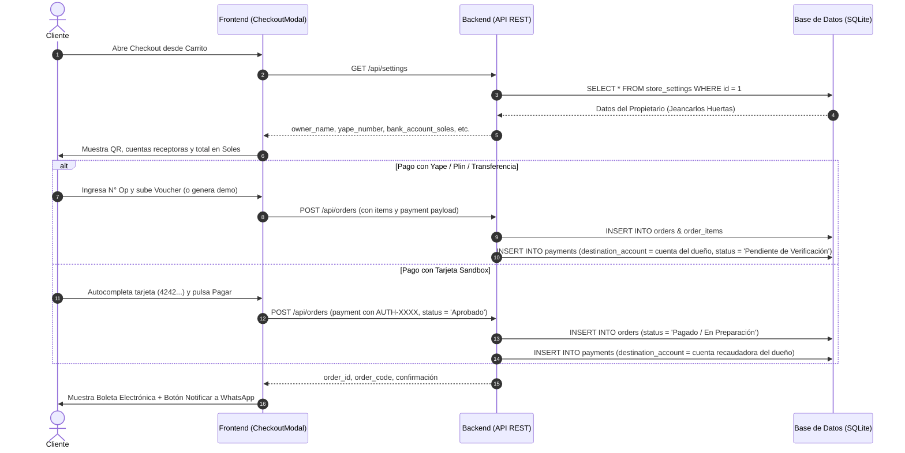

# Data Model & Entidades: Módulo 002 - Pasarela de Checkout

## 1. Flujo de Entidades en el Proceso de Pago

---

## 2. Estructura de la Tabla `payments` en el Módulo 002

| Campo | Tipo | Obligatorio | Descripción / Formato en Módulo 002 |
|---|---|---|---|
| `id` | INTEGER | Sí | Clave primaria autonumérica. |
| `order_id` | INTEGER | Sí | Clave foránea referenciando a `orders(id)`. |
| `method` | TEXT | Sí | `'Yape'`, `'Plin'`, `'Transferencia Bancaria'` o `'Tarjeta Crédito/Débito'`. |
| `destination_account` | TEXT | Sí | **Cuenta receptora oficial del propietario**, construida dinámicamente según la vía elegida:  • Yape: `"Yape: 924046690 (Jeancarlos José Huertas Quichca)"` • Plin: `"Plin: 983064501 (Jeancarlos José Huertas Quichca)"` • BCP: `"BCP - Banco de Crédito del Perú Cta: 22079349234041 (Jeancarlos José Huertas Quichca)"` • Tarjeta: `"Cuenta Recaudadora BCP: 22079349234041 (Jeancarlos José Huertas Quichca)"` |
| `amount` | REAL | Sí | Monto total liquidado en Soles coincidentes con `orders.total`. |
| `currency` | TEXT | Sí | Moneda oficial del pago (`'PEN'`). |
| `operation_number` | TEXT | Condicional | Número de operación bancaria o de billetera (6 a 8 dígitos). |
| `voucher_image` | TEXT | Condicional | Imagen del comprobante de transferencia o voucher en formato Base64 (`data:image/png;base64,...`). |
| `card_last4` | TEXT | Condicional | Últimos 4 dígitos de la tarjeta utilizada (`'4242'`). |
| `auth_code` | TEXT | Condicional | Clave de autorización simulada por la pasarela (`AUTH-XXXX`). |
| `payment_status` | TEXT | Sí | `'Pendiente de Verificación'` (Yape/Plin/Transferencia) o `'Aprobado'` (Tarjeta Sandbox). |
| `created_at` | DATETIME | Sí | Marca temporal de la transacción (`CURRENT_TIMESTAMP`). |

---

## 3. Estados de Pedidos y Transiciones (`orders.order_status`)

1. **`Pendiente de Pago`**: Estado inicial si el pago no se ha registrado o está en espera.
2. **`En Verificación`**: Se asigna cuando el comprador sube su voucher de **Yape**, **Plin** o constancia de **Transferencia Bancaria**. Queda listo para validación por parte del administrador en el Panel de Administración.
3. **`Pagado / En Preparación`**: Se asigna automáticamente cuando el cliente paga con **Tarjeta de Crédito/Débito Sandbox**, dado que la pasarela autoriza el cobro de inmediato con código `AUTH-XXXX`.
4. **`Enviado` / `Entregado`**: Estados posteriores de logística física.
5. **`Cancelado`**: Si el voucher es inválido o el comprador desiste.
