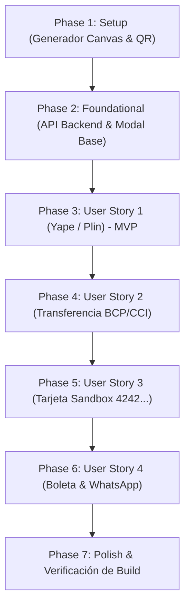

# Tasks: Módulo 002 - Pasarela de Checkout Dirigida a las Cuentas del Propietario (Yape/Plin, Transferencia y Tarjeta)

**Input**: Documentos de diseño desde `/specs/002-pagos-a-mi-cuenta-yape-plin/` (`spec.md`, `plan.md`, `data-model.md`, `contracts/api-contracts.md`, `research.md`, `quickstart.md`)  
**Prerequisites**: Módulo 001 completado en `main`, rama activa `002-pagos-a-mi-cuenta-yape-plin`, base de datos SQLite con tablas `store_settings`, `users`, `products`, `orders`, `order_items` y `payments`  
**Tests**: Pruebas manuales y end-to-end según escenarios en [quickstart.md](./quickstart.md)  
**Organization**: Tareas agrupadas por historias de usuario ([US1], [US2], [US3], [US4]) para entrega y verificación independiente.

---

## Format: `- [ ] [ID] [P?] [Story] Description with file path`

- **[P]**: Ejecutable en paralelo (archivos independientes sin bloqueos)
- **[Story]**: Historia de usuario asignada ([US1], [US2], [US3], [US4])
- Cada descripción contiene rutas exactas y restricciones literales del modelo de datos

---

## Phase 1: Setup (Infraestructura Compartida)

**Purpose**: Creación de generadores visuales auxiliares para comprobantes demo y códigos QR.

- [X] T001 [P] Crear el generador Canvas de comprobantes bancarios peruanos auténticos (Yape, Plin y BCP) con logotipo, fecha/hora, monto en Soles (`S/`), N° de operación y titular en `frontend/src/utils/voucherGenerator.js`
- [X] T002 [P] Implementar la función de generación de código QR dinámico vectorial SVG para cobros móviles con número y monto en `frontend/src/utils/qrGenerator.js`

---

## Phase 2: Foundational (Prerrequisitos Bloqueantes)

**Purpose**: Endpoint de consulta/creación de órdenes y estructura base del modal de checkout en 2 pasos.

> **CRITICAL**: Esta fase debe completarse antes de iniciar las historias de usuario específicas.

- [X] T003 Actualizar el endpoint `POST /api/orders` y agregar `GET /api/orders/:id` en `backend/src/routes/orders.js` soportando estados de orden (`'Pagado / En Preparación'`, `'En Verificación'`, `'Pendiente de Pago'`) y persistencia íntegra de `payments` (`destination_account`, `voucher_image`, `operation_number`, `auth_code`, `payment_status`)
- [X] T004 [P] Agregar el método `getOrderById: (id) => request('/orders/' + id)` al cliente HTTP en `frontend/src/services/api.js`
- [X] T005 Crear el armazón del modal de Checkout en 2 pasos (`Paso 1: Datos del Comprador` con precarga de nombre, DNI de 8 dígitos, teléfono móvil de 9 dígitos y dirección; `Paso 2: Método de Pago` con selector de pestañas) en `frontend/src/components/CheckoutModal.jsx`
- [X] T006 Conectar la apertura del `CheckoutModal` desde el botón 'Ir a Pagar (Checkout)' en `frontend/src/components/CartDrawer.jsx` y coordinar su estado visible en `frontend/src/App.jsx`

**Checkpoint**: Base lista: el backend acepta órdenes con pagos detallados y el frontend abre el modal de checkout en 2 pasos.

---

## Phase 3: User Story 1 - Pago por Billeteras Digitales Yape y Plin del Propietario (Priority: P1) 🎯 MVP

**Goal**: Permitir al cliente pagar mediante Yape o Plin leyendo de `store_settings` el número y titular del propietario, mostrando QR dinámico, autocompletando N° de operación demo o voucher demo, y guardando `destination_account` en SQLite.

**Independent Test**: Abrir el checkout con suplementos en el carrito, seleccionar Yape o Plin, usar "Generar N° Operación Demo" y "Cargar Voucher de Prueba", confirmar y verificar en SQLite que `payments.destination_account` registre `"Yape: 924046690 (Jeancarlos José Huertas Quichca)"` o `"Plin: 983064501 (Jeancarlos José Huertas Quichca)"` con `payment_status: 'Pendiente de Verificación'`.

### Implementation for User Story 1

- [X] T007 [P] [US1] Diseñar la pestaña interactiva de pago por Yape en `frontend/src/components/CheckoutModal.jsx` mostrando titular `owner_name` ('Jeancarlos José Huertas Quichca'), número `yape_number` ('924046690'), botón 'Copiar Número' con feedback visual y código QR dinámico con el importe en Soles (`S/`)
- [X] T008 [P] [US1] Diseñar la pestaña interactiva de pago por Plin en `frontend/src/components/CheckoutModal.jsx` mostrando titular `owner_name` ('Jeancarlos José Huertas Quichca'), número `plin_number` ('983064501'), botón 'Copiar Número' con feedback visual y código QR dinámico con el importe en Soles (`S/`)
- [X] T009 [US1] Integrar el botón 'Generar N° Operación Demo' (correlativo de 6 a 8 dígitos) y el botón 'Cargar Voucher de Prueba' en `frontend/src/components/CheckoutModal.jsx` usando `voucherGenerator.js`
- [X] T010 [US1] Implementar el input para subida manual de voucher con conversión a Base64 (`data:image/png;base64,...`), validación de tamaño (< 5 MB) y previsualización gráfica en `frontend/src/components/CheckoutModal.jsx`
- [X] T011 [US1] Implementar el despacho de la orden por Yape/Plin registrando `destination_account` literal (`"Yape: " + yape_number + " (" + owner_name + ")"` o `"Plin: " + plin_number + " (" + owner_name + ")"`) y `payment_status: 'Pendiente de Verificación'` en `frontend/src/components/CheckoutModal.jsx`

**Checkpoint**: Al completar esta fase, el MVP de pagos por Yape y Plin funciona de punta a punta y es verificable independientemente.

---

## Phase 4: User Story 2 - Pago por Transferencia Bancaria Directa a Cuenta y CCI (Priority: P2)

**Goal**: Permitir pagos por transferencia bancaria a la cuenta y CCI del propietario en el BCP, con botones de copiado en 1 clic, N° de operación y comprobante de transferencia guardados en SQLite.

**Independent Test**: Seleccionar "Transferencia Bancaria" en el checkout, verificar la tarjeta BCP con número de cuenta y CCI, presionar los botones de copiado comprobando el feedback, cargar comprobante demo y confirmar, verificando en SQLite que `destination_account` contenga `'BCP - Banco de Crédito del Perú Cta: 22079349234041 (Jeancarlos José Huertas Quichca)'`.

### Implementation for User Story 2

- [X] T012 [P] [US2] Diseñar la tarjeta bancaria visual BCP en `frontend/src/components/CheckoutModal.jsx` mostrando `bank_name` ('BCP - Banco de Crédito del Perú'), `owner_name` ('Jeancarlos José Huertas Quichca'), número de cuenta en Soles `bank_account_soles` ('22079349234041') y CCI `bank_cci` ('00222017934923404128')
- [X] T013 [P] [US2] Implementar los botones de copiado rápido 'Copiar N° Cuenta' y 'Copiar CCI' con confirmación visual interactiva ("¡Copiado!") en `frontend/src/components/CheckoutModal.jsx`
- [X] T014 [US2] Integrar el campo de N° de Operación bancaria (con botón 'Generar N° Operación Demo') y carga de voucher de transferencia (con botón 'Cargar Comprobante Demo' BCP) en `frontend/src/components/CheckoutModal.jsx`
- [X] T015 [US2] Implementar el despacho de la orden por transferencia registrando `destination_account` literal (`bank_name + " Cta: " + bank_account_soles + " (" + owner_name + ")"`) y `payment_status: 'Pendiente de Verificación'` en `frontend/src/components/CheckoutModal.jsx`

**Checkpoint**: Las Vías 1 (Yape/Plin) y 2 (Transferencia BCP/CCI) funcionan y guardan sus cuentas receptoras en SQLite.

---

## Phase 5: User Story 3 - Pasarela de Tarjeta Sandbox con Liquidación a Cuenta Recaudadora (Priority: P3)

**Goal**: Proveer formulario interactivo de tarjeta con autocompletado Sandbox en 1 clic (`4242...`), aviso explícito de abono a la cuenta recaudadora del dueño, clave de autorización `AUTH-XXXX` y estado automático `'Pagado / En Preparación'`.

**Independent Test**: Seleccionar Tarjeta, pulsar "Autocompletar Tarjeta Sandbox (4242...)", presionar "Pagar con Tarjeta", verificar el procesamiento en 800 ms y confirmar en SQLite que la orden quede `'Pagado / En Preparación'`, el pago `'Aprobado'` con `auth_code: 'AUTH-XXXX'` y `destination_account` referenciando la cuenta recaudadora.

### Implementation for User Story 3

- [X] T016 [P] [US3] Construir el formulario interactivo de tarjeta (número de 16 dígitos formateado con espacios, titular, expiración MM/AA, CVV de 3 dígitos y selector de 1 a 12 cuotas) en `frontend/src/components/CheckoutModal.jsx`
- [X] T017 [P] [US3] Implementar el botón 'Autocompletar Tarjeta Sandbox (4242...)' que rellene tarjeta `4242 4242 4242 4242`, titular del cliente activo, expiración futura (`12/28`) y CVV `123` en `frontend/src/components/CheckoutModal.jsx`
- [X] T018 [US3] Desplegar el aviso de seguridad en el formulario de tarjeta: *"El cobro procesado se depositará automáticamente en la cuenta recaudadora N° {bank_account_soles} de {owner_name}"* en `frontend/src/components/CheckoutModal.jsx`
- [X] T019 [US3] Implementar la simulación de procesamiento bancario (800 ms), generación de `auth_code` (`'AUTH-' + random`), asignación de `destination_account` (`"Cuenta Recaudadora BCP: " + bank_account_soles + " (" + owner_name + ")"`), `card_last4: '4242'` y despacho con `order_status: 'Pagado / En Preparación'` en `frontend/src/components/CheckoutModal.jsx`

**Checkpoint**: Las 3 modalidades de cobro (Billeteras móviles, Transferencia y Tarjeta Sandbox) están plenamente operativas.

---

## Phase 6: User Story 4 - Boleta Electrónica y Notificación Directa a WhatsApp del Propietario (Priority: P4)

**Goal**: Mostrar la Boleta Electrónica interactiva con código correlativo, desglose de suplementos, cuenta receptora del propietario, vaciar el carrito y permitir enviar constancia a WhatsApp oficial (`983064501`) en 1 clic.

**Independent Test**: Completar un pedido por cualquier método, verificar que aparezca la Boleta Electrónica con la cuenta de cobro exacta, comprobar que el carrito se haya vaciado de inmediato, hacer clic en "Notificar compra y enviar voucher a mi WhatsApp" y verificar que el enlace abra `https://wa.me/51983064501` con el texto prellenado.

### Implementation for User Story 4

- [X] T020 [P] [US4] Construir el componente de Boleta Electrónica formal con diseño peruano (código `ORD-2026-XXX`, fecha, cliente, DNI, dirección, detalle de suplementos, Subtotal, Envío, Total en `S/`, cuenta receptora y voucher) en `frontend/src/components/ElectronicReceipt.jsx`
- [X] T021 [US4] Implementar el botón 'Notificar compra y enviar voucher a mi WhatsApp' que genera y abre el enlace `https://wa.me/51${whatsapp_notification}?text=...` con el código de orden, total, método y N° de operación en `frontend/src/components/ElectronicReceipt.jsx`
- [X] T022 [US4] Implementar el vaciado automático del carrito de compras (limpiando el estado reactivo en `CartContext` y `localStorage`) al confirmarse el pedido en `frontend/src/components/CheckoutModal.jsx`
- [X] T023 [US4] Integrar la consulta y reapertura de la Boleta Electrónica con comprobante desde el historial de pedidos del cliente en `frontend/src/components/ProfileView.jsx`

**Checkpoint**: El ciclo completo de compra concluye con comprobante electrónico, notificación a WhatsApp y sincronización con el historial del cliente.

---

## Phase 7: Polish & Cross-Cutting Concerns

**Purpose**: Validación de casos borde, sincronización de configuración y verificación de compilación sin errores.

- [X] T024 [P] Validar el manejo de casos borde en `frontend/src/components/CheckoutModal.jsx`: advertir si el carrito está vacío, validar longitud de N° de operación (6 a 8 dígitos), y rechazar vouchers no imagen o superiores a 5 MB
- [X] T025 Sincronizar en tiempo real `store_settings` entre la base de datos SQLite y el CheckoutModal para reflejar cambios inmediatos del titular o cuentas en `frontend/src/App.jsx`
- [X] T026 Ejecutar la compilación integral del frontend con `npm run build` verificando cero errores de sintaxis o empaquetado en el proyecto
- [X] T027 Ejecutar la verificación de extremo a extremo de las 4 modalidades de cobro según [quickstart.md](./quickstart.md) comprobando los registros en la base de datos `database.sqlite`

---

## Dependencies & Execution Order

### Phase Dependencies

### User Story Dependencies

- **US1 (P1 - Yape/Plin)**: Requiere Phase 2 (Foundational). No depende de otras historias. Constituye el **MVP**.
- **US2 (P2 - Transferencia BCP)**: Requiere Phase 2. Reutiliza el flujo de voucher y N° de operación establecido en US1.
- **US3 (P3 - Tarjeta Sandbox)**: Requiere Phase 2. Opera de manera independiente en su propia pestaña interactiva.
- **US4 (P4 - Boleta & WhatsApp)**: Consume los datos de la orden generada por US1, US2 o US3 para emitir el comprobante y abrir WhatsApp.

### Parallel Opportunities

- **Phase 1**: `T001` (voucherGenerator) y `T002` (qrGenerator) se pueden implementar en paralelo al trabajar en archivos distintos.
- **Phase 2**: `T004` (api.js) y `T005` (CheckoutModal.jsx) se pueden estructurar en paralelo mientras se actualiza `T003` (orders.js).
- **Phase 3**: `T007` (pestaña Yape) y `T008` (pestaña Plin) pueden diseñarse en paralelo.
- **Phase 4**: `T012` (tarjeta BCP) y `T013` (copiado CCI) se pueden codificar en paralelo.
- **Phase 5**: `T016` (formulario tarjeta) y `T017` (autocompletado 4242) son independientes del backend.
- **Phase 6**: `T020` (ElectronicReceipt.jsx) se puede diseñar de forma aislada a los controladores de checkout.

---

## Implementation Strategy

### MVP First (User Story 1 - Cobros Yape / Plin)

1. Completar **Phase 1 (Setup)**: Generadores de voucher Canvas y código QR.
2. Completar **Phase 2 (Foundational)**: Endpoints de órdenes y esqueleto del modal de checkout en 2 pasos.
3. Completar **Phase 3 (User Story 1)**: Flujo completo de Yape y Plin con N° de op demo, voucher demo y guardado de `destination_account` en SQLite.
4. **Validar MVP**: Probar compra por Yape y confirmar persistencia en `payments`.

### Incremental Delivery

1. Setup + Foundation → Base de checkout activa.
2. User Story 1 (P1) → Pagos por Yape y Plin con comprobante demo (MVP funcional).
3. User Story 2 (P2) → Pagos por Transferencia Bancaria BCP con copiado de CCI.
4. User Story 3 (P3) → Pasarela de Tarjeta Sandbox con código `AUTH-XXXX` y aviso de liquidación al dueño.
5. User Story 4 (P4) → Emisión de Boleta Electrónica formal, vaciado de carrito y notificación a WhatsApp (`983064501`).
6. Polish → Casos borde, comprobación de integridad y build sin errores (`npm run build`).
