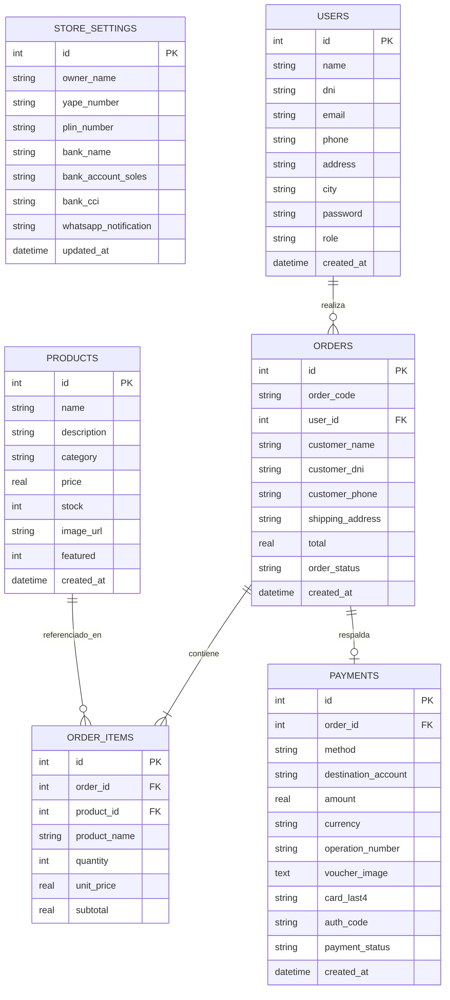
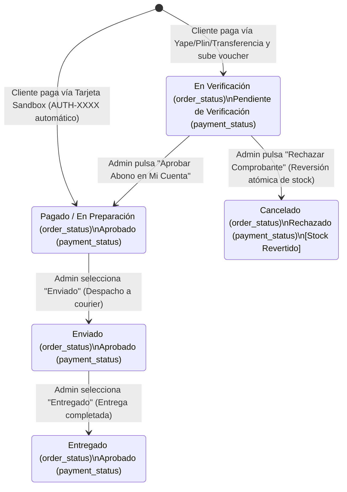

# Data Model & Entidades: Módulo 003 - Panel de Administración

## 1. Diagrama de Relaciones y Entidades Administradas



---

## 2. Ciclo de Vida y Transiciones de Estados de Pagos y Pedidos



---

## 3. Comportamiento Atómico del Inventario (`products.stock`)

1. **Al crear un pedido en Checkout (Módulo 002)**:
   ```sql
   UPDATE products
   SET stock = MAX(0, stock - ?)
   WHERE id = ?;
   ```
2. **Al aprobar el comprobante (Módulo 003)**:
   - El inventario se mantiene igual (ya fue reservado).
   - Se actualiza `payments.payment_status = 'Aprobado'` y `orders.order_status = 'Pagado / En Preparación'`.
3. **Al rechazar el comprobante (Módulo 003)**:
   - Para cada ítem del pedido en `order_items`:
     ```sql
     UPDATE products
     SET stock = stock + ?
     WHERE id = ?;
     ```
   - Se actualiza `payments.payment_status = 'Rechazado'` y `orders.order_status = 'Cancelado'`.
4. **Al crear o editar productos desde el panel (Módulo 003)**:
   - El administrador puede aumentar o disminuir el valor de `stock` directamente desde el modal de edición, impactando en tiempo real en la tienda del cliente.

---

## 4. Estructura de Consulta de Clientes Enriquecida

Para la **Pestaña 3 (Gestión de Clientes)**, la API REST devuelve los usuarios con rol `'client'` agrupando sus estadísticas comerciales:

| Campo | Tipo | Origen | Descripción |
|---|---|---|---|
| `id` | INTEGER | `users.id` | Identificador único del cliente. |
| `name` | TEXT | `users.name` | Nombre y apellido del cliente. |
| `dni` | TEXT | `users.dni` | DNI de 8 dígitos numéricos. |
| `email` | TEXT | `users.email` | Correo electrónico de contacto. |
| `phone` | TEXT | `users.phone` | Celular peruano de 9 dígitos numéricos. |
| `address` | TEXT | `users.address` | Dirección de envío habitual. |
| `city` | TEXT | `users.city` | Ciudad / Destino de entrega. |
| `orders_count` | INTEGER | Agregación `COUNT(orders.id)` | Cantidad histórica de pedidos realizados. |
| `total_spent` | REAL | Agregación `SUM(orders.total)` | Monto acumulado en Soles (`S/`) de pedidos no cancelados. |
