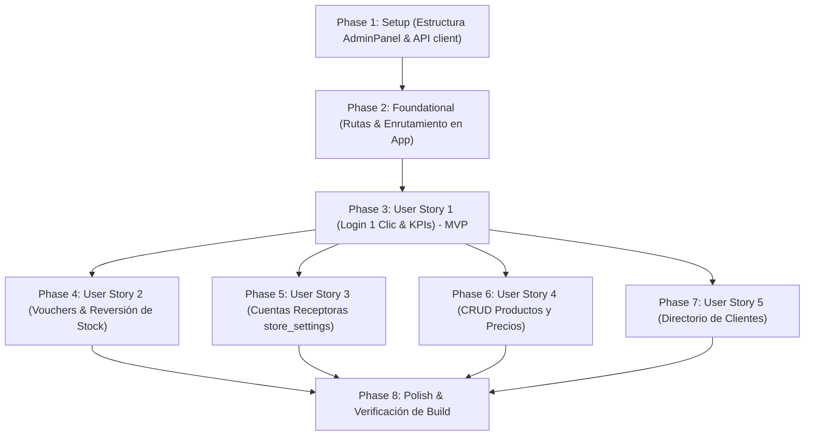

# Tasks: Módulo 003 - Panel de Administración Completo (Productos, Precios, Clientes, Pedidos y Cuentas de Cobro)

**Input**: Documentos de diseño desde `/specs/003-modulo-administracion/` (`spec.md`, `plan.md`, `data-model.md`, `contracts/api-contracts.md`, `research.md`, `quickstart.md`)  
**Prerequisites**: Módulos 001 y 002 completados en `main`, rama activa `003-modulo-administracion`, base de datos SQLite con tablas `store_settings`, `users`, `products`, `orders`, `order_items` y `payments`  
**Tests**: Pruebas manuales y end-to-end según escenarios en [quickstart.md](./quickstart.md)  
**Organization**: Tareas agrupadas por historias de usuario ([US1] a [US5]) para entrega y verificación independiente.

---

## Format: `- [ ] [ID] [P?] [Story] Description with file path`

- **[P]**: Ejecutable en paralelo (archivos independientes sin bloqueos)
- **[Story]**: Historia de usuario asignada ([US1], [US2], [US3], [US4], [US5])
- Cada descripción contiene rutas exactas y restricciones literales del modelo de datos

---

## Phase 1: Setup (Infraestructura Compartida)

**Purpose**: Esqueleto del componente de administración y métodos del cliente HTTP.

- [ ] T001 [P] Crear la estructura base del componente maestro `AdminPanel.jsx` con encabezado, sistema de tabs de navegación y modal de login demo en `frontend/src/components/AdminPanel.jsx`
- [ ] T002 [P] Agregar los métodos administrativos (`createProduct`, `updateProduct`, `deleteProduct`, `updateOrderStatus`, `updatePaymentStatus`) al cliente HTTP en `frontend/src/services/api.js`

---

## Phase 2: Foundational (Prerrequisitos Bloqueantes)

**Purpose**: Enrutamiento de navegación hacia el panel y endpoints de soporte.

> **CRITICAL**: Esta fase debe completarse antes de iniciar las historias de usuario específicas.

- [ ] T003 Integrar la navegación hacia `'admin'` en `Header.jsx` y coordinar la renderización condicional de `AdminPanel.jsx` según `activeTab` en `frontend/src/App.jsx`
- [ ] T004 [P] Implementar el endpoint `GET /api/orders` con datos completos de ítems, pagos y destinatario en `backend/src/routes/orders.js` para abastecer el cálculo de KPIs del panel

**Checkpoint**: Base lista: el administrador puede acceder a la ruta de administración y consultar la lista de pedidos en SQLite.

---

## Phase 3: User Story 1 - Login Admin en 1 Clic y Dashboard Financiero con KPIs (Priority: P1) 🎯 MVP

**Goal**: Permitir al administrador iniciar sesión en 1 clic con `admin@fitstore.pe` / `admin123`, persistir la sesión en `localStorage` y ver el Dashboard ejecutivo con 4 métricas financieras y operativas en tiempo real.

**Independent Test**: Hacer clic en "Panel Admin" en la barra superior, pulsar "Acceso Rápido Admin Demo", y verificar que se ingrese de inmediato mostrando las 4 tarjetas de KPIs con valores reales de SQLite (Total Recaudado en `S/`, Vouchers Pendientes, Catálogo y Clientes).

### Implementation for User Story 1

- [ ] T005 [P] [US1] Construir la pantalla de login con el botón 'Acceso Rápido Admin Demo (1 clic)' que autocomplete las credenciales `admin@fitstore.pe` / `admin123` y guarde la sesión en `localStorage` (`fitstore_admin_auth = true`) en `frontend/src/components/AdminPanel.jsx`
- [ ] T006 [P] [US1] Diseñar las 4 tarjetas de KPIs ejecutivos en tiempo real (Total Recaudado en Soles `S/`, Pagos Pendientes con badge de alerta, Catálogo con advertencia de stock $\le 5$, Total Clientes) en `frontend/src/components/AdminPanel.jsx`
- [ ] T007 [US1] Implementar el botón de 'Cerrar Sesión Admin' (limpiando `localStorage`) y el botón de retorno rápido a la Tienda del Cliente en `frontend/src/components/AdminPanel.jsx`

**Checkpoint**: Al completar esta fase, el MVP de acceso administrativo y dashboard financiero funciona de punta a punta y es verificable independientemente.

---

## Phase 4: User Story 2 - Verificación de Vouchers, Aprobación/Rechazo con Reversión de Stock y Despacho (Priority: P2)

**Goal**: Permitir al propietario revisar comprobantes de pago subidos por los clientes, aprobar abonos (`'Aprobado'` / `'Pagado / En Preparación'`), rechazar vouchers fraudulentos revirtiendo automáticamente el stock a `products`, y avanzar pedidos a `'Enviado'` o `'Entregado'`.

**Independent Test**: Crear una compra por Yape desde la tienda, abrir la Pestaña de Pedidos en el Panel Admin, abrir "Ver Voucher", pulsar "Aprobar Abono en Mi Cuenta" y comprobar que pase a `'Pagado / En Preparación'`. Luego, probar con otra orden el botón "Rechazar Comprobante" y verificar que el stock de los suplementos se devuelva automáticamente en SQLite.

### Implementation for User Story 2

- [ ] T008 [P] [US2] Implementar el endpoint `PUT /api/orders/:id/payment` en `backend/src/routes/orders.js` soportando `'Aprobado'` (orden `'Pagado / En Preparación'`) y `'Rechazado'` (orden `'Cancelado'` con reversión atómica de stock en `products`)
- [ ] T009 [P] [US2] Implementar el endpoint `PUT /api/orders/:id/status` en `backend/src/routes/orders.js` para actualizar el avance logístico del pedido a `'Enviado'` o `'Entregado'`
- [ ] T010 [US2] Construir la Pestaña 2 (Gestión de Pedidos y Conciliación) con tabla interactiva, filtros por estado (`Todos`, `En Verificación`, `Pagado`, `Enviado`, `Entregado`, `Cancelado`) y visualización de `destination_account` en `frontend/src/components/AdminPanel.jsx`
- [ ] T011 [US2] Diseñar el modal 'Ver Voucher / Comprobante' en alta resolución con datos de transferencia (`destination_account`, monto en `S/`, N° operación) y botones 'Aprobar Abono en Mi Cuenta' y 'Rechazar Comprobante' en `frontend/src/components/AdminPanel.jsx`

**Checkpoint**: La conciliación bancaria directa de Yape/Plin y BCP está 100% operativa con protección de inventario.

---

## Phase 5: User Story 3 - Configuración en Vivo de Cuentas Receptoras del Propietario (Priority: P3)

**Goal**: Permitir al propietario auditar y modificar en caliente sus cuentas de cobro (`store_settings`: Titular, Yape, Plin, Banco BCP, Cuenta Soles, CCI, WhatsApp) con validación de 9 dígitos y propagación inmediata al Checkout de los clientes.

**Independent Test**: Modificar el número de Yape o la cuenta BCP en la Pestaña 4 de Configuración, guardar, regresar a la Tienda, abrir el Checkout y verificar que los nuevos datos se muestren en el modal de cobro y en el código QR.

### Implementation for User Story 3

- [ ] T012 [P] [US3] Agregar validaciones de longitud (números telefónicos de exactamente 9 dígitos numéricos) en el endpoint `PUT /api/settings` en `backend/src/routes/settings.js`
- [ ] T013 [US3] Construir la Pestaña 4 (Mis Cuentas Receptoras) con formulario conectado a `store_settings` para editar titular `owner_name`, `yape_number`, `plin_number`, `bank_name`, `bank_account_soles`, `bank_cci` y `whatsapp_notification` en `frontend/src/components/AdminPanel.jsx`
- [ ] T014 [US3] Implementar la propagación reactiva de `store_settings` al guardar cambios para actualizar el estado global en `frontend/src/App.jsx` impactando en tiempo real en el Checkout y Footer de la tienda

**Checkpoint**: El propietario puede cambiar sus números de recaudación en vivo sin reiniciar el servidor.

---

## Phase 6: User Story 4 - Catálogo y CRUD Completo de Productos, Precios y Stock (Priority: P4)

**Goal**: Proveer tabla interactiva de productos con buscador y modales para Crear, Editar Precios/Stock en caliente (impactando en la tienda) y Eliminar productos preservando los históricos en `order_items`.

**Independent Test**: Crear un suplemento nuevo desde el panel admin, modificar su precio y stock, volver a la tienda y verificar que aparezca con el precio actualizado. Luego, eliminarlo y confirmar que el catálogo público se actualice.

### Implementation for User Story 4

- [ ] T015 [P] [US4] Implementar el endpoint `POST /api/products` en `backend/src/routes/products.js` para registrar suplementos con categoría ('Proteínas', 'Creatinas', 'Pre-Entrenos', 'Accesorios'), precio en Soles (`REAL`), stock (`INTEGER`), imagen y flag destacado
- [ ] T016 [P] [US4] Implementar el endpoint `PUT /api/products/:id` en `backend/src/routes/products.js` para actualizar en caliente datos, precios y stock de productos
- [ ] T017 [P] [US4] Implementar el endpoint `DELETE /api/products/:id` en `backend/src/routes/products.js` retirando el producto del catálogo activo preservando el registro histórico en `order_items`
- [ ] T018 [US4] Construir la Pestaña 1 (Productos y Precios) con tabla responsiva, buscador en tiempo real e insignias visuales de '¡Bajo Stock!' ($\le 5$) y 'Agotado' (0) en `frontend/src/components/AdminPanel.jsx`
- [ ] T019 [US4] Implementar el modal de Creación y Edición de Productos y Precios con selector de imágenes fitness de muestra en `frontend/src/components/AdminPanel.jsx`
- [ ] T020 [US4] Integrar la confirmación y ejecución de eliminación de productos en `frontend/src/components/AdminPanel.jsx`

**Checkpoint**: El catálogo de FitStore Pro se gestiona dinámicamente con actualización instantánea de precios.

---

## Phase 7: User Story 5 - Directorio y Gestión Integral de Clientes (Priority: P5)

**Goal**: Proveer directorio de clientes con DNI (8 dígitos), compras acumuladas y gasto en Soles (`S/`), con opción de crear clientes nuevos o editar datos personales de clientes existentes.

**Independent Test**: Ingresar a la Pestaña 3, verificar que se listen los clientes con sus compras acumuladas y total gastado en Soles (`S/`), editar la dirección de un cliente y crear un cliente nuevo con DNI de 8 dígitos validando su registro en SQLite.

### Implementation for User Story 5

- [ ] T021 [P] [US5] Actualizar el endpoint `GET /api/users` en `backend/src/routes/users.js` para incluir las métricas agregadas `orders_count` y `total_spent` en Soles (`S/`) por cliente
- [ ] T022 [US5] Construir la Pestaña 3 (Gestión de Clientes) con tabla de clientes, DNI (8 dígitos), teléfono (9 dígitos), dirección, conteo de compras y total gastado en `frontend/src/components/AdminPanel.jsx`
- [ ] T023 [US5] Integrar los modales para editar datos de clientes existentes y registrar nuevos clientes en SQLite en `frontend/src/components/AdminPanel.jsx`

**Checkpoint**: El directorio de clientes y sus estadísticas comerciales están completamente integrados.

---

## Phase 8: Polish & Cross-Cutting Concerns

**Purpose**: Validación de casos borde, alertas visuales y verificación de build sin errores.

- [ ] T024 [P] Validar el manejo de estados de carga (skeletons / spinners), notificaciones de éxito y errores visuales en `frontend/src/components/AdminPanel.jsx`
- [ ] T025 Sincronizar el badge del botón 'Panel Admin' en `Header.jsx` para alertar cuántos pagos pendientes de verificación existen en tiempo real
- [ ] T026 Ejecutar la compilación integral del proyecto con `npm run build` verificando cero errores de sintaxis o empaquetado en frontend y backend
- [ ] T027 Ejecutar la verificación de extremo a extremo de los 5 escenarios administrativos según [quickstart.md](./quickstart.md) en la base de datos `database.sqlite`

---

## Dependencies & Execution Order

### Phase Dependencies

### User Story Dependencies

- **US1 (P1 - Login & KPIs)**: Requiere Phase 2 (Foundational). Constituye el **MVP**.
- **US2 (P2 - Vouchers & Stock)**: Requiere Phase 2 y el dashboard de US1.
- **US3 (P3 - store_settings)**: Opera en su pestaña independiente.
- **US4 (P4 - Productos y Precios)**: Opera en su pestaña independiente.
- **US5 (P5 - Clientes)**: Consume las órdenes creadas en SQLite.

### Parallel Opportunities

- **Phase 1**: `T001` (AdminPanel.jsx) y `T002` (api.js) pueden desarrollarse en paralelo.
- **Phase 3**: `T005` (Login) y `T006` (KPIs) pueden crearse en paralelo.
- **Phase 4**: `T008` (payment endpoint) y `T009` (status endpoint) pueden implementarse en paralelo.
- **Phase 6**: `T015`, `T016` y `T017` en backend pueden implementarse en paralelo antes de la UI `T018`.

---

## Implementation Strategy

### MVP First (User Story 1 - Login 1 Clic & Dashboard)

1. Completar **Phase 1 (Setup)**: Estructura base de `AdminPanel.jsx` y métodos API.
2. Completar **Phase 2 (Foundational)**: Enrutamiento en `App.jsx` y endpoint de órdenes.
3. Completar **Phase 3 (User Story 1)**: Login en 1 clic y Dashboard con 4 KPIs.
4. **Validar MVP**: Probar ingreso con `admin@fitstore.pe` / `admin123` y visualización de métricas.

### Incremental Delivery

1. Setup + Foundation → Entrada al panel admin habilitada.
2. User Story 1 (P1) → Login 1 clic y KPIs financieros (MVP funcional).
3. User Story 2 (P2) → Verificación de vouchers con aprobación y reversión atómica de stock.
4. User Story 3 (P3) → Configuración en caliente de cuentas del propietario (`store_settings`).
5. User Story 4 (P4) → CRUD completo de productos y actualización en caliente de precios.
6. User Story 5 (P5) → Directorio de clientes con estadísticas comerciales.
7. Polish → Validación de casos borde, sincronización de alertas y `npm run build` sin errores.
