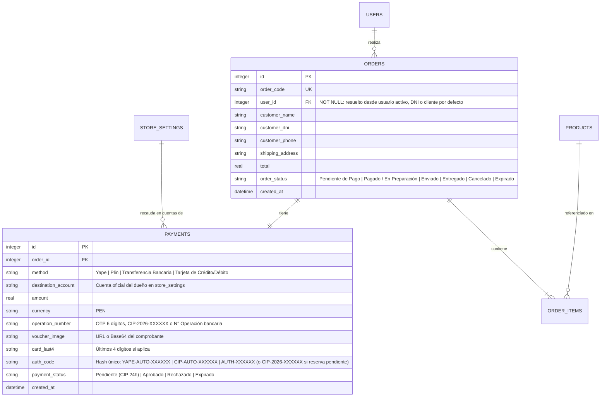
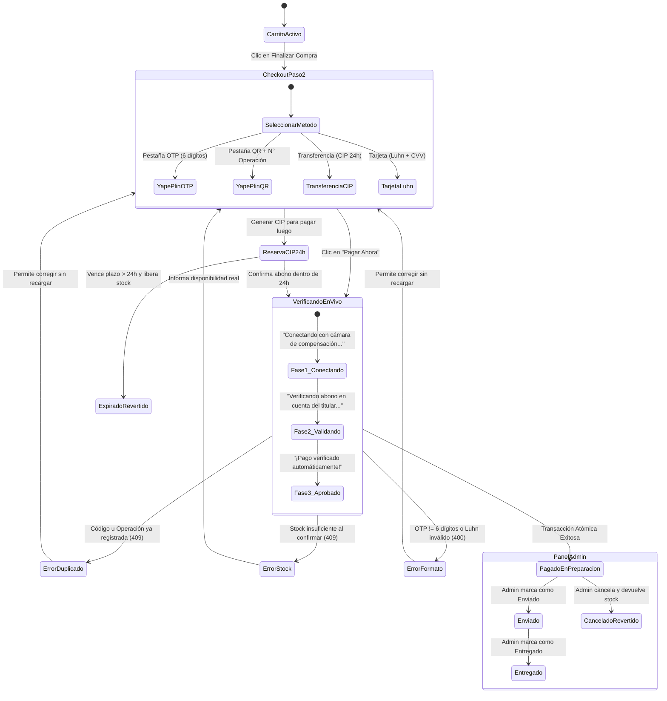

# Data Model & Entidades: Módulo 004 - Motor de Verificación Automática de Pagos

**Feature Branch**: `004-verificacion-automatica-pagos`  
**Date**: 2026-11-06  
**Status**: Completed  
**Spec**: [spec.md](./spec.md)

---

## 1. Esquema Relacional de Base de Datos (SQLite)

El módulo se apoya en las tablas existentes `orders`, `payments`, `order_items`, `products` y `store_settings`, asegurando integridad referencial y atomicidad.



---

## 2. Entidades y Modelos de Datos en Memoria (DTOs)

### A. Objeto de Solicitud de Verificación Automática (`PaymentVerificationRequest`)
Enviado desde el frontend al endpoint `POST /api/payments/auto-verify`:

```json
{
  "method": "yape_plin",
  "action": "verify",
  "verification_mode": "otp",
  "user_id": 2,
  "order_id": null,
  "phone": "987654321",
  "otp_code": "492104",
  "operation_number": null,
  "cip_code": null,
  "card_data": null,
  "items": [
    { "product_id": 1, "product_name": "Gold Standard 100% Whey 2lb", "quantity": 1, "unit_price": 189.90 }
  ],
  "customer": {
    "name": "Carlos Mendoza Ríos",
    "dni": "72458912",
    "phone": "987654321",
    "address": "Av. Arequipa 2450, Dpto 402, Lima",
    "city": "Lima"
  },
  "total": 189.90
}
```

### B. Objeto de Respuesta de Verificación Exitosa (`AutoVerificationResponse`)
Retornado por el backend tras completar la transacción atómica:

```json
{
  "success": true,
  "message": "¡Pago verificado automáticamente! Orden aprobada.",
  "order": {
    "id": 14,
    "order_code": "ORD-2026-014",
    "total": 189.90,
    "order_status": "Pagado / En Preparación",
    "created_at": "2026-11-06T15:55:00.000Z",
    "auto_verified": true
  },
  "payment": {
    "id": 14,
    "method": "Yape",
    "payment_status": "Aprobado",
    "auth_code": "YAPE-AUTO-948215",
    "operation_number": "492104",
    "destination_account": "Yape titular: 924046690 (Jeancarlos José Huertas Quichca)",
    "amount": 189.90,
    "currency": "PEN"
  },
  "audit": {
    "verified_at": "2026-11-06T15:55:02.500Z",
    "verification_latency_ms": 2500,
    "channel": "Camara de Compensacion Digital Yape/Plin",
    "beneficiary": "Jeancarlos José Huertas Quichca"
  }
}
```

---

## 3. Máquina de Estados de la Transacción



---

## 4. Reglas de Negocio y Validación de Entidades
1. **Unicidad de Operación**: La tabla `payments` valida que no exista ningún registro previo con el mismo `operation_number` o `auth_code` en estado `'Aprobado'`.
2. **Formato Numérico y Hashes de Auditoría**:
   - Celular Yape/Plin: Exactamente 9 dígitos numéricos (`/^\d{9}$/`).
   - Código OTP Yape: Exactamente 6 dígitos numéricos (`/^\d{6}$/`), no repetitivos triviales (`000000`, `111111`). Hash de auditoría: `YAPE-AUTO-XXXXXX`.
   - Transferencia CIP: Código de referencia para transferir `CIP-2026-XXXXXX` (vigencia 24 horas). Hash de auditoría tras aprobar: `CIP-AUTO-XXXXXX`.
   - Tarjeta Crédito/Débito: Validación Luhn + fecha vigente + CVV 3-4 dígitos. Hash de auditoría: `AUTH-XXXXXX`.
3. **Consistencia de Stock y Atomicidad**: Toda reserva CIP, aprobación automática, expiración (> 24h) o cancelación administrativa ejecuta la modificación de existencias en `products` dentro de una transacción explícita de `node:sqlite` (`BEGIN IMMEDIATE` ... `COMMIT` / `ROLLBACK`).
4. **Integridad `user_id NOT NULL`**: Cuando una compra automática no recibe un `user_id` explícito, el backend resuelve por DNI existente en `users` o asigna el cliente demo base, garantizando cumplimiento de la clave foránea `orders.user_id`.
