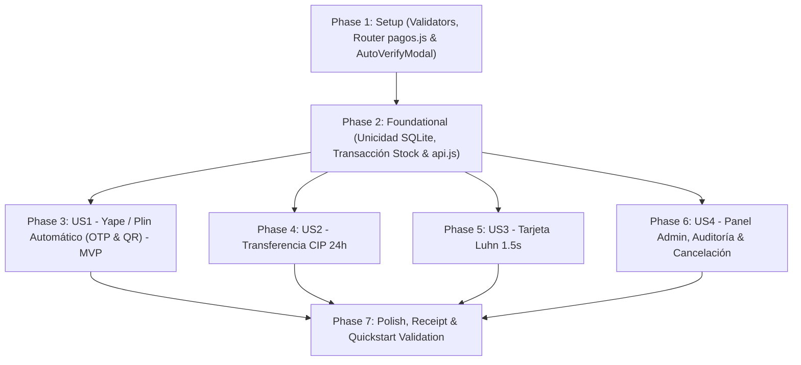

# Tasks: Módulo 004 - Motor de Verificación Automática e Instantánea de Pagos

**Input**: Documentos de diseño desde `/specs/004-verificacion-automatica-pagos/` (`spec.md`, `plan.md`, `research.md`, `data-model.md`, `contracts/api-contracts.md`, `quickstart.md`)  
**Prerequisites**: Rama activa `004-verificacion-automatica-pagos`, base de datos SQLite (`backend/database.sqlite`) con las 6 tablas base (`users`, `products`, `orders`, `order_items`, `payments`, `store_settings`)  
**Tests**: Pruebas de integración de endpoints y flujos interactivos end-to-end según escenarios en [quickstart.md](./quickstart.md)  
**Organization**: Tareas agrupadas por historias de usuario ([US1] a [US4]) para entrega y verificación independiente.

---

## Format: `- [ ] [ID] [P?] [Story] Description with file path`

- **[P]**: Ejecutable en paralelo (archivos independientes sin bloqueos)
- **[Story]**: Historia de usuario asignada (`[US1]`, `[US2]`, `[US3]`, `[US4]`)
- Cada descripción incluye rutas exactas de archivos y restricciones literales de validación del modelo de datos

---

## Phase 1: Setup (Infraestructura Compartida)

**Purpose**: Creación de módulos base de rutas de verificación en backend, utilidades algorítmicas y componente modal animado en frontend.

- [X] T001 Crear utilidades compartidas de validación financiera (algoritmo de Luhn módulo 10, regex celular peruano `/^\d{9}$/`, código OTP Yape `/^\d{6}$/` rechazando secuencias triviales `000000`/`111111`, generadores de referencia `CIP-2026-XXXXXX` y hashes de auditoría `YAPE-AUTO-XXXXXX`, `CIP-AUTO-XXXXXX`, `AUTH-XXXXXX`) en `backend/src/utils/paymentValidators.js`
- [X] T002 [P] Crear la estructura inicial del router de pagos automáticos en `backend/src/routes/payments.js` y montarlo bajo `/api/payments` en `backend/src/server.js`
- [X] T003 [P] Crear la estructura base del modal animado de verificación en tiempo real (3 fases secuenciales con indicador visual estilo Temu/Shein) en `frontend/src/components/AutoVerifyModal.jsx`

---

## Phase 2: Foundational (Prerrequisitos Bloqueantes)

**Purpose**: Núcleo transaccional en SQLite, prevención antifraude anti-duplicados y capa de cliente API compartida por todas las historias.

> **CRITICAL**: Esta fase debe completarse antes de iniciar las historias de usuario específicas.

- [X] T004 Verificar e indexar la consulta de unicidad en la tabla `payments` (verificando que `operation_number` y `auth_code` no existan en estado `'Aprobado'`, devolviendo HTTP `409 Conflict` con error `'DUPLICATE_OPERATION'`) dentro de `backend/src/routes/payments.js` y asegurar soporte de columnas/índices en `backend/src/db/seed.js`
- [X] T005 Implementar la función transaccional atómica (`BEGIN IMMEDIATE` ... `COMMIT` / `ROLLBACK` en `node:sqlite`) en `backend/src/routes/payments.js`: resolver `user_id` (`NOT NULL` en `orders`, buscando por `user_id`, `customer.dni` o cliente demo), validar existencias `stock >= quantity` (retornando HTTP `409 INSUFFICIENT_STOCK` si falta stock), insertar en `orders` (`'Pagado / En Preparación'`), `order_items`, `payments` (`'Aprobado'`) y descontar stock en `products`
- [X] T006 [P] Añadir los métodos `autoVerifyPayment(payload)`, `getPaymentAudit(orderCode)` y `cancelOrder(orderId)` en `frontend/src/services/api.js` conservando mensajes de error y `error` code del servidor (`400`, `409`, `410`)

**Checkpoint**: Fundación lista: el backend soporta verificación atómica con control anti-duplicados y el frontend posee los adaptadores REST.

---

## Phase 3: User Story 1 - Verificación Automática e Instantánea de Yape y Plin (Priority: P1) 🎯 MVP

**Goal**: Permitir al cliente pagar con Yape/Plin mediante pestañas conmutables (Código OTP de 6 dígitos estilo Temu por defecto o escaneo QR + N° de Operación), experimentar el modal animado de 3 fases en 2.5 segundos y obtener la aprobación automática e inmediata de su pedido.

**Independent Test**: Abrir `CheckoutModal`, seleccionar Yape/Plin, ingresar celular de 9 dígitos y código OTP de 6 dígitos (ej. `492104`), pulsar "Pagar Ahora" y comprobar que `AutoVerifyModal` anima las 3 fases en 2.5s, que la orden pasa a `'Pagado / En Preparación'` con hash `YAPE-AUTO-XXXXXX`, se descuenta stock en SQLite y se bloquea cualquier reintento duplicado con error HTTP `409`.

### Implementation for User Story 1

- [X] T007 [US1] Implementar en `backend/src/routes/payments.js` el manejador `method === 'yape_plin'` dentro de `POST /api/payments/auto-verify`, validando celular de 9 dígitos (`/^\d{9}$/`), modo `'otp'` (código `/^\d{6}$/` no trivial) o modo `'qr'` (`operation_number` único), vinculando `destination_account` al número Yape/Plin de `store_settings` (`924046690` / `983064501`, titular `Jeancarlos José Huertas Quichca`) y generando `auth_code` con formato `YAPE-AUTO-XXXXXX`
- [X] T008 [P] [US1] Implementar en `frontend/src/components/AutoVerifyModal.jsx` la línea de tiempo animada de 2.5 segundos con 3 estados secuenciales (`'🔄 Conectando con cámara de compensación Yape / Plin...'`, `'🔍 Verificando operación y abono en la cuenta de Jeancarlos José Huertas Quichca...'`, `'✅ ¡Pago verificado automáticamente! Orden aprobada.'`), soporte para estado de error amigable (`409` duplicado / `400` formato inválido) sin cerrar el checkout
- [X] T009 [US1] Actualizar `frontend/src/components/CheckoutModal.jsx` para añadir pestañas conmutables dentro de Yape/Plin: Pestaña 1 `'Código de Aprobación Yape (6 dígitos)'` (predeterminada, pidiendo celular 9 dígitos + OTP 6 dígitos) y Pestaña 2 `'Escanear QR + N° de Operación'`, conectando ambas al disparador de `AutoVerifyModal` y `api.autoVerifyPayment()` para emitir la boleta en el paso 3

**Checkpoint**: El flujo MVP de pago instantáneo con Yape/Plin estilo Temu opera de extremo a punta con control antifraude y \$0.00 de comisiones.

---

## Phase 4: User Story 2 - Verificación Automática Banco a Banco con Código CIP / Transferencia (Priority: P2)

**Goal**: Generar un Código de Pago CIP único (`CIP-2026-XXXXXX`) con vigencia de 24 horas y temporizador regresivo visible para transferencias a la cuenta BCP/CCI del propietario, validando el monto exacto y aprobando el pedido automáticamente al confirmar la operación bancaria.

**Independent Test**: Seleccionar Transferencia Bancaria en `CheckoutModal`, comprobar la visualización del código `CIP-2026-XXXXXX`, temporizador de 24:00:00 y cuentas del dueño (`22079349234041` / CCI `00222017934923404128`), ingresar operación bancaria y validar que el endpoint apruebe automáticamente la orden con hash `CIP-AUTO-XXXXXX` y `payment_status = 'Aprobado'`.

### Implementation for User Story 2

- [X] T010 [US2] Implementar en `backend/src/routes/payments.js` la lógica para `method === 'bank_transfer'` dentro de `POST /api/payments/auto-verify`: soportar `action: 'reserve_cip'` (orden `'Pendiente de Pago'`, pago `'Pendiente (CIP 24h)'` con `CIP-2026-XXXXXX` reservando stock) y `action: 'verify'` (validando referencia CIP, N° operación bancaria único, monto exacto `total` en `PEN`, cuenta BCP/CCI de `store_settings`, emitiendo `auth_code = 'CIP-AUTO-XXXXXX'`), más la función `expireOverdueCipOrders()` que expira órdenes CIP > 24h (`order_status = 'Expirado'`, `payment_status = 'Expirado'`, liberando stock y devolviendo HTTP `410 CIP_EXPIRED`)
- [X] T011 [P] [US2] Implementar el generador de código CIP determinista por sesión (`CIP-2026-XXXXXX`) y un temporizador regresivo en vivo de 24 horas (formato `HH:MM:SS`) dentro de `frontend/src/components/CheckoutModal.jsx` junto a los botones rápidos de copia para Cuenta BCP y CCI
- [X] T012 [US2] Conectar la confirmación de Transferencia Bancaria en `frontend/src/components/CheckoutModal.jsx` con `AutoVerifyModal.jsx` (adaptando los textos de compensación al canal interbancario CCI/BCP del propietario en `< 2.0s` para aprobar al instante, o permitiendo generar la reserva CIP de 24h para confirmar luego desde la boleta)

**Checkpoint**: Las transferencias directas Banco a Banco / CCI operan con código CIP de 24h y conciliación automática sin intervención manual.

---

## Phase 5: User Story 3 - Autorización Inmediata con Tarjeta de Crédito/Débito y Liquidación al Dueño (Priority: P3)

**Goal**: Procesar pagos con tarjeta ejecutando validación algorítmica local (Luhn módulo 10, fecha vigente y CVV de 3 dígitos), autorizando el cobro en 1.5 segundos con código `AUTH-XXXXXX` y registrando la liquidación explícita hacia la cuenta recaudadora del propietario en SQLite.

**Independent Test**: Seleccionar Tarjeta de Crédito/Débito en `CheckoutModal`, ingresar tarjeta válida (ej. `4242 4242 4242 4242`) o probar con una tarjeta que falle Luhn (verificando rechazo claro en español), confirmar cobro y comprobar aprobación en 1.5s con código `AUTH-XXXXXX` y boleta liquidada al propietario.

### Implementation for User Story 3

- [X] T013 [US3] Implementar en `backend/src/routes/payments.js` el manejo de `method === 'credit_card'` dentro de `POST /api/payments/auto-verify`, ejecutando validación Luhn, comprobación de fecha de expiración vigente (`MM/AA` >= fecha actual) y CVV de 3-4 dígitos, almacenando `card_last4`, generando `auth_code` unívoco `AUTH-XXXXXX` y registrando la cuenta recaudadora de `store_settings` en `destination_account`
- [X] T014 [P] [US3] Integrar validación en vivo de Luhn, fecha y CVV con mensajes claros en español peruano dentro de la sección de Tarjeta en `frontend/src/components/CheckoutModal.jsx`
- [X] T015 [US3] Conectar el envío del formulario de Tarjeta en `frontend/src/components/CheckoutModal.jsx` con `AutoVerifyModal.jsx` (animación rápida de 1.5s de tokenización 3D Secure y liquidación a cuenta bancaria del dueño) para emitir la boleta electrónica pagada

**Checkpoint**: Los 3 canales de cobro (Yape/Plin, Transferencia CIP, Tarjeta) cuentan con verificación automática instantánea unificada.

---

## Phase 6: User Story 4 - Auditoría y Automatización en el Panel de Administración (Priority: P4)

**Goal**: Permitir que el Administrador visualice las órdenes aprobadas automáticamente con la insignia `'✓ Verificado Automáticamente'`, consulte un modal detallado de auditoría bancaria (`GET /api/payments/audit/:orderCode`), vea el impacto instantáneo en el KPI de recaudación y gestione el despacho (`Enviado`, `Entregado`) o la cancelación con reversión atómica de stock (`POST /api/orders/:id/cancel`).

**Independent Test**: Ingresar al Panel de Administración (`admin@fitstore.pe`), verificar que el contador de pagos pendientes manuales sea 0, que los pedidos muestren el badge `'✓ Verificado Automáticamente'`, abrir el modal "Ver Auditoría" confirmando el hash `YAPE-AUTO-`/`CIP-AUTO-`/`AUTH-` y probar "Cancelar Orden" verificando el incremento restaurado en el stock de productos.

### Implementation for User Story 4

- [X] T016 [P] [US4] Implementar el endpoint `GET /api/payments/audit/:orderCode` en `backend/src/routes/payments.js` retornando el detalle de conciliación automática (hash, canal, cuenta de destino del titular, monto, fecha/hora e ítems)
- [X] T017 [P] [US4] Implementar el endpoint `POST /api/orders/:id/cancel` en `backend/src/routes/orders.js` (y añadir `'Expirado'` a `validStatuses` más la invocación de `expireOverdueCipOrders()` en `GET /api/orders` y `GET /api/orders/user/:userId`) para cambiar `order_status = 'Cancelado'` y `payment_status = 'Rechazado'` de forma transaccional (`BEGIN IMMEDIATE` ... `COMMIT`), devolviendo atómicamente cada `item.quantity` al `stock` de `products` en SQLite siempre que la orden no estuviera ya cancelada o expirada
- [X] T018 [US4] Actualizar `frontend/src/components/AdminPanel.jsx` para renderizar el badge verde `'✓ Verificado Automáticamente'` en las órdenes con hash automático (`YAPE-AUTO-`, `CIP-AUTO-`, `AUTH-`), agregar el modal de inspección de auditoría conectado a `api.getPaymentAudit()` y añadir el botón de `'Cancelar y Devolver Stock'` conectado a `api.cancelOrder()` junto a los botones de despacho rápido `'Enviado'` y `'Entregado'`

**Checkpoint**: El Panel de Administración opera 100% automatizado en cobros con trazabilidad financiera completa y control operativo logístico.

---

## Phase 7: Polish & Cross-Cutting Concerns

**Purpose**: Ajustes transversales en boleta electrónica, validación de compilación y pruebas integrales del quickstart.

- [X] T019 [P] Actualizar `frontend/src/components/ElectronicReceipt.jsx` para exhibir el badge `'✓ Verificado Automáticamente'`, el código/hash bancario de auditoría (`YAPE-AUTO-`, `CIP-AUTO-`, `AUTH-`), y para reservas CIP pendientes (`'Pendiente (CIP 24h)'`) el temporizador regresivo de 24h con acceso para verificar el abono vía `AutoVerifyModal`
- [X] T020 Ejecutar compilación de producción con `npm run build` garantizando cero errores de sintaxis, empaquetado o JSX en `frontend` y verificar carga limpia de rutas en `backend`
- [X] T021 Ejecutar prueba completa de los 6 escenarios de verificación end-to-end documentados en `specs/004-verificacion-automatica-pagos/quickstart.md` (Yape OTP 2.5s, rechazo anti-duplicados `409`, CIP 24h, Tarjeta Luhn, Auditoría Admin y Reversión de stock)

---

## Dependencies & Execution Order

### Phase Dependencies



### User Story Dependencies

- **Setup (Phase 1)** -> **Foundational (Phase 2)**: Prerrequisito absoluto; habilita validadores compartidos, transacciones en SQLite y métodos `api.js`.
- **US1 (P1 - MVP)**: Depende de Phase 2. Habilita el validador automático para Yape/Plin y el modal animado estilo Temu.
- **US2 (P2)** y **US3 (P3)**: Dependen de Phase 2 y reutilizan `AutoVerifyModal.jsx` creado en US1/Setup para sus canales bancarios y tarjetas.
- **US4 (P4)**: Depende de Phase 2 (`payments` y `orders` persistidos) y puede desarrollarse en paralelo a US2 y US3.
- **Polish (Phase 7)**: Depende de la finalización de US1 a US4 para validar la boleta digital, build y todos los escenarios de `quickstart.md`.

### Parallel Opportunities

- **Phase 1**: `T001` (validadores backend), `T002` (router backend) y `T003` (UI `AutoVerifyModal.jsx`) operan sobre archivos completamente independientes.
- **Phase 2**: `T006` (`frontend/src/services/api.js`) puede avanzar en paralelo a `T004`/`T005` en el backend.
- **Phase 3 (US1)**: `T008` (animación visual en `AutoVerifyModal.jsx`) puede desarrollarse en paralelo a `T007` (lógica backend en `payments.js`).
- **Phase 4 & Phase 5**: Los bloques visuales de CIP (`T011`) y Luhn (`T014`) pueden avanzar en paralelo a sus endpoints backend (`T010`, `T013`).
- **Phase 6 (US4)**: Los endpoints `GET /api/payments/audit/:orderCode` (`T016`) y `POST /api/orders/:id/cancel` (`T017`) son independientes y paralelizables entre sí.

---

## Parallel Example: User Story 1

```text
Paralelizar backend y frontend de US1 tras completar Phase 2:
- Worker / Turno A: T007 [US1] Manejador yape_plin y anti-duplicados en backend/src/routes/payments.js
- Worker / Turno B: T008 [P] [US1] Animación secuencial 2.5s (3 fases) en frontend/src/components/AutoVerifyModal.jsx
Integración final de US1:
- T009 [US1] Pestañas OTP / QR y conexión en frontend/src/components/CheckoutModal.jsx
```

---

## Implementation Strategy

### MVP First (User Story 1 Only)
1. Completar **Phase 1 (Setup)** y **Phase 2 (Foundational)**.
2. Completar **Phase 3 (User Story 1 - Yape / Plin Automático)**.
3. **STOP and VALIDATE**: Probar Escenario 1 y Escenario 2 de [quickstart.md](./quickstart.md) (pago Yape OTP en 2.5s + bloqueo `409 Conflict` ante operación repetida).
4. El MVP ya entrega valor comercial inmediato sin intervención manual para el método de pago más usado en el Perú.

### Incremental Delivery
1. Setup + Foundational → Motor transaccional listo.
2. + User Story 1 → Yape/Plin instantáneo estilo Temu/Shein (**MVP!**).
3. + User Story 2 → Transferencias bancarias con código CIP 24h.
4. + User Story 3 → Tarjetas con validación Luhn y liquidación al titular.
5. + User Story 4 → Auditoría y reversión atómica de stock en Panel Admin.
6. Polish → Boleta actualizada + `npm run build` + verificación integral de los 6 escenarios.
