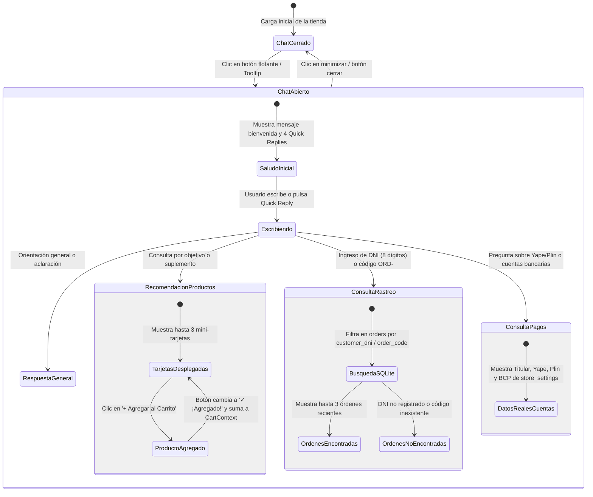

# Data Model & State Architecture: Módulo 005 - Chatbot Asesor Deportivo Inteligente (FitBot)

**Feature**: `005-chatbot-asesor-fitbot` | **Date**: 2026-11-06

---

## 1. Estructura de Datos Conversacionales (Frontend State)

### Entidad: `ChatMessage`
Representa cada interacción individual dentro del historial de conversación de FitBot.

| Campo | Tipo | Requerido | Descripción |
|---|---|:---:|---|
| `id` | `string` | Sí | Identificador unívoco del mensaje (ej. `msg-1730908200-1`). |
| `sender` | `'bot' \| 'user'` | Sí | Emisor del mensaje (`bot` para FitBot, `user` para el comprador). |
| `text` | `string` | Sí | Contenido textual principal del mensaje con formato y emojis. |
| `timestamp` | `string` | Sí | Hora de emisión del mensaje en formato local (ej. `10:15 a. m.`). |
| `type` | `string` | Sí | Tipo de contenido: `'text'`, `'products'`, `'order_tracking'`, `'payment_info'`, `'welcome'`. |
| `products` | `ProductCardData[]` | No | Lista de hasta 3 suplementos sugeridos con stock vigente. |
| `orders` | `OrderTrackingSummary[]` | No | Lista de hasta 3 compras encontradas por DNI o código de pedido. |
| `paymentData` | `StorePaymentInfo` | No | Cuentas oficiales del propietario obtenidas de `store_settings`. |

---

### Entidad: `ProductCardData`
Estructura de datos para las mini-tarjetas interactivas renderizadas dentro del chat.

| Campo | Tipo | Descripción |
|---|---|---|
| `id` | `number` | Identificador único del producto en la tabla `products` de SQLite. |
| `name` | `string` | Nombre comercial del suplemento (ej. *Gold Standard 100% Whey 2lb*). |
| `category` | `string` | Categoría oficial: `'Proteínas'`, `'Creatinas'`, `'Pre-Entrenos'`, `'Accesorios'`. |
| `price` | `number` | Precio oficial de venta en Soles peruanos (`S/`). |
| `stock` | `number` | Cantidad de unidades físicas disponibles en inventario. |
| `image_url` | `string` | URL de la imagen del producto en alta resolución. |
| `description` | `string` | Breve extracto explicativo del suplemento para el comprador. |

---

### Entidad: `OrderTrackingSummary`
Estructura de respuesta cuando el cliente solicita rastreo por DNI o código de orden.

| Campo | Tipo | Descripción |
|---|---|---|
| `order_code` | `string` | Código oficial del pedido (ej. `ORD-2026-003`). |
| `created_at` | `string` | Fecha y hora en que se registró la compra en SQLite. |
| `customer_name` | `string` | Nombre del cliente registrado en la orden. |
| `customer_dni` | `string` | Documento Nacional de Identidad (8 dígitos numéricos). |
| `total` | `number` | Monto total abonado o por abonar en Soles (`S/`). |
| `order_status` | `string` | Estado logístico: `'Pendiente de Pago'`, `'En Verificación'`, `'Pagado / En Preparación'`, `'Enviado'`, `'Entregado'`, `'Cancelado'`. |
| `payment_status` | `string` | Estado del abono: `'Pendiente de Verificación'`, `'Aprobado'`, `'Rechazado'`. |
| `payment_method` | `string` | Método utilizado: `'Yape'`, `'Plin'`, `'Transferencia'`, `'Tarjeta'`. |
| `items_summary` | `string` | Resumen de productos comprados (ej. `1x Gold Standard Whey, 1x Creatina Creapure`). |

---

### Entidad: `StorePaymentInfo`
Estructura con los datos oficiales de recaudación obtenidos de la tabla `store_settings`.

| Campo | Tipo | Valor Predeterminado en Sistema |
|---|---|---|
| `owner_name` | `string` | `Jeancarlos José Huertas Quichca` |
| `yape_number` | `string` | `924046690` |
| `plin_number` | `string` | `983064501` |
| `bank_name` | `string` | `BCP - Banco de Crédito del Perú` |
| `bank_account_soles` | `string` | `22079349234041` |
| `bank_cci` | `string` | `00222017934923404128` |
| `whatsapp_notification` | `string` | `983064501` |

---

## 2. Máquina de Estados de la Conversación de FitBot

---

## 3. Reglas de Validación y Negocio

1. **Límite de Productos en el Chat**:
   - Toda recomendación de productos debe contener un **máximo de 3 mini-tarjetas** para garantizar legibilidad.
   - Solo se muestran productos con `stock > 0`, salvo que la consulta explícita del usuario sea por un suplemento agotado, en cuyo caso se muestra con la etiqueta *"Agotado"* y botón inhabilitado.
2. **Validación de Identidad Peruana (DNI)**:
   - Para rastreo de órdenes, el sistema valida que el DNI contenga **exactamente 8 dígitos numéricos** (`/^\d{8}$/`). Si el cliente ingresa un número de 7 o 9 dígitos, FitBot aclara que el DNI peruano debe constar de 8 dígitos.
3. **Persistencia de Sesión (`sessionStorage`)**:
   - Los mensajes se guardan en el almacenamiento de sesión del navegador para sobrevivir al cambio de vistas (`store`, `profile`, `admin`) y no perder el diálogo activo mientras el comprador explora la tienda.
4. **Adición Inmediata al Carrito**:
   - Al pulsar `+ Agregar al Carrito` en una tarjeta del chat, el producto se añade con cantidad 1 al `CartContext`. Si el producto ya estaba en el carrito, se incrementa su cantidad validando que no supere el stock máximo disponible.

