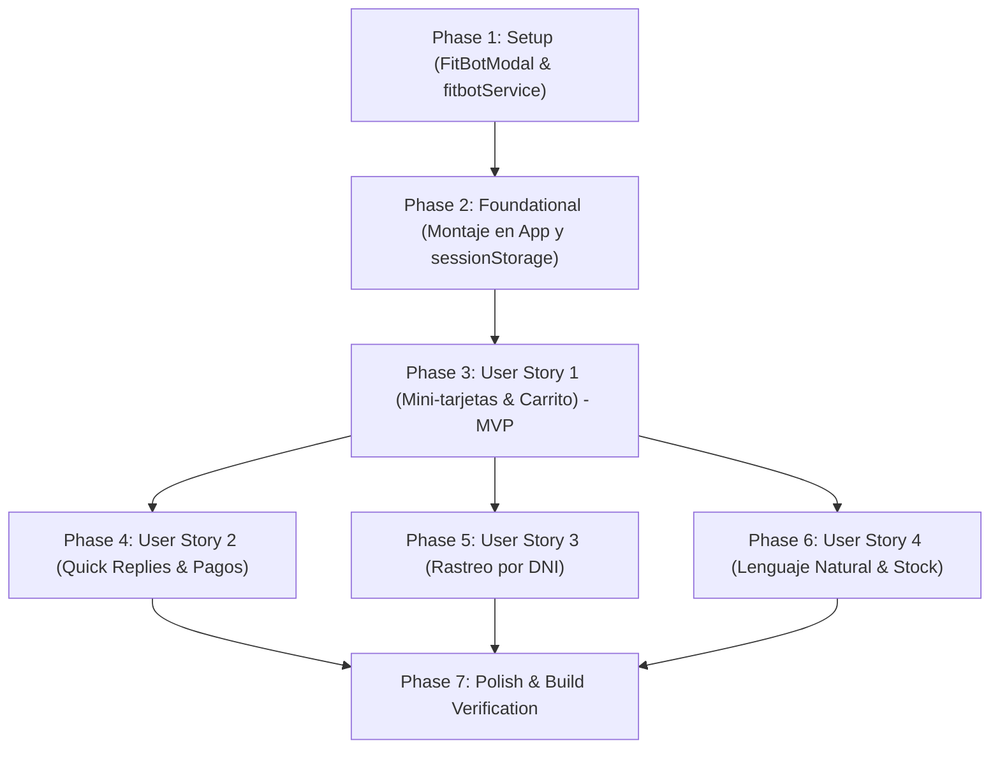

# Tasks: Módulo 005 - Chatbot Asesor Deportivo Inteligente (FitBot)

**Input**: Documentos de diseño desde `/specs/005-chatbot-asesor-fitbot/` (`spec.md`, `plan.md`, `research.md`, `data-model.md`, `contracts/api-contracts.md`, `quickstart.md`)  
**Prerequisites**: Módulos 001, 002 y 003 completados en `main`, rama activa `005-chatbot-asesor-fitbot`, base de datos SQLite con tablas `products`, `orders`, `order_items` y `store_settings`  
**Tests**: Pruebas interactivas y de flujo según escenarios en [quickstart.md](./quickstart.md)  
**Organization**: Tareas agrupadas por historias de usuario ([US1] a [US4]) para entrega y verificación independiente.

---

## Format: `- [ ] [ID] [P?] [Story] Description with file path`

- **[P]**: Ejecutable en paralelo (archivos independientes sin bloqueos)
- **[Story]**: Historia de usuario asignada ([US1], [US2], [US3], [US4])
- Cada descripción contiene rutas exactas y restricciones literales del modelo de datos

---

## Phase 1: Setup (Infraestructura Compartida)

**Purpose**: Esqueleto del componente flotante y del motor de asesoría conversacional.

- [X] T001 Crear el archivo base del motor conversacional local en `frontend/src/services/fitbotService.js`
- [X] T002 [P] Crear la estructura visual base del widget flotante de chat en `frontend/src/components/FitBotModal.jsx`

---

## Phase 2: Foundational (Prerrequisitos Bloqueantes)

**Purpose**: Integración de persistencia de sesión y montaje en la aplicación principal.

> **CRITICAL**: Esta fase debe completarse antes de iniciar las historias de usuario específicas.

- [X] T003 Configurar la gestión de mensajes y persistencia en `sessionStorage` (`fitstore_fitbot_history`) en `frontend/src/services/fitbotService.js`
- [X] T004 [P] Montar el componente `FitBotModal.jsx` dentro de `frontend/src/App.jsx` conectándolo a `storeSettings` y al contexto global de compras

**Checkpoint**: Base lista: el botón flotante de FitBot se visualiza en la tienda y abre la ventana vacía del chat.

---

## Phase 3: User Story 1 - Consulta por Objetivos y Adición Directa al Carrito (Priority: P1) 🎯 MVP

**Goal**: Permitir al comprador recibir sugerencias de suplementos según metas físicas y agregar productos al carrito de compras con 1 clic directamente desde las tarjetas del chat.

**Independent Test**: Abrir FitBot, solicitar un suplemento para masa muscular, comprobar que se desplieguen hasta 3 mini-tarjetas con foto, nombre, precio en `S/` y stock, y al pulsar "+ Agregar al Carrito", verificar que el contador del header suba y el botón cambie a "✓ ¡Agregado!" sin cerrar el chat.

### Implementation for User Story 1

- [X] T005 [P] [US1] Diseñar e implementar el componente visual de mini-tarjetas de producto (máximo 3 ítems, foto, nombre, precio oficial en Soles `S/`, indicador de stock y botón de adición) dentro de `frontend/src/components/FitBotModal.jsx`
- [X] T006 [US1] Conectar el botón '+ Agregar al Carrito' de cada mini-tarjeta con `useCart()` en `frontend/src/components/FitBotModal.jsx`, aplicando la animación y cambio a '✓ ¡Agregado!' durante 1.8 segundos manteniendo el chat abierto
- [X] T007 [US1] Implementar el retardo de escritura humanizado ('FitBot está escribiendo...', 400ms) y el auto-scroll hacia el mensaje más reciente en `frontend/src/components/FitBotModal.jsx`

**Checkpoint**: Al completar esta fase, el MVP de asesoría con adición directa al carrito funciona de punta a punta de forma verificable.

---

## Phase 4: User Story 2 - Botones de Consulta Rápida (1 Clic) y Respuestas de Cuentas de Cobro (Priority: P2)

**Goal**: Proveer accesos directos para metas populares y consulta en vivo de los datos de cobro oficiales del propietario (`store_settings`).

**Independent Test**: Abrir FitBot, pulsar el botón rápido "💳 ¿Cómo pagar con Yape / Plin / Cuenta?", y verificar que se muestre el titular oficial y los números de Yape, Plin y BCP/CCI vigentes en la base de datos SQLite.

### Implementation for User Story 2

- [X] T008 [P] [US2] Implementar la botonera de acciones rápidas (Quick Replies) con las 4 opciones obligatorias ('💪 Ganar masa muscular', '⚡ Energía y Pre-entreno', '📦 Consultar estado de mi pedido', '💳 ¿Cómo pagar con Yape / Plin / Cuenta?') en `frontend/src/components/FitBotModal.jsx`
- [X] T009 [US2] Implementar en `frontend/src/services/fitbotService.js` la respuesta dinámica de cuentas de cobro extrayendo el titular `Jeancarlos José Huertas Quichca`, Yape `924046690`, Plin `983064501`, BCP `22079349234041` y CCI de `store_settings` con botón copiar

**Checkpoint**: Los compradores pueden resolver dudas de pago o iniciar recomendaciones con un solo clic.

---

## Phase 5: User Story 3 - Rastreo de Pedidos en Vivo desde la Conversación (Priority: P3)

**Goal**: Permitir al cliente consultar el estado de sus pedidos en SQLite mediante su DNI (8 dígitos) o código `ORD-` sin salir de la tienda.

**Independent Test**: Ingresar en el chat el DNI "72458912" o un código "ORD-2026-001", y comprobar que FitBot liste hasta 3 compras recientes con su estado (`Pendiente`, `En Verificación`, `Pagado / En Preparación`, `Enviado`, `Entregado`) y productos comprados.

### Implementation for User Story 3

- [X] T010 [P] [US3] Implementar la validación y extracción de DNI peruano de 8 dígitos numéricos (`/^\d{8}$/`) y códigos correlativos `ORD-` en `frontend/src/services/fitbotService.js`
- [X] T011 [US3] Conectar el motor con `api.getAllOrders()` para filtrar órdenes por DNI o código y retornar hasta 3 compras recientes ordenadas descendentemente en `frontend/src/services/fitbotService.js`
- [X] T012 [US3] Diseñar el componente visual de resumen de pedido con badges de estado de pago y avance logístico en `frontend/src/components/FitBotModal.jsx`

**Checkpoint**: El autoservicio de rastreo de pedidos opera en tiempo real desde la conversación.

---

## Phase 6: User Story 4 - Asesoría Fitness Contextual y Búsqueda en Lenguaje Natural (Priority: P4)

**Goal**: Interpretar términos en lenguaje natural (ej. "proteína", "creatina", "definición", "fuerza", "algo barato") y manejar productos agotados con alternativas en stock.

**Independent Test**: Escribir en el chat frases libres como "algo económico" o "quiero quemar grasa", y verificar que FitBot filtre y ordene los suplementos correspondientes en Soles (`S/`), señalando adecuadamente si algún producto está agotado.

### Implementation for User Story 4

- [X] T013 [P] [US4] Desarrollar el algoritmo de normalización de texto y mapeo semántico de intenciones deportivas ('Proteínas', 'Creatinas', 'Pre-Entrenos', 'Accesorios', económico por precio) en `frontend/src/services/fitbotService.js`
- [X] T014 [US4] Implementar el filtro de inventario en `frontend/src/services/fitbotService.js` para priorizar suplementos con existencias activas y sugerir alternativas ante productos agotados
- [X] T015 [US4] Implementar respuestas de cortesía, orientaciones sobre dosis y reorientación temática ante consultas ajenas a nutrición deportiva en `frontend/src/services/fitbotService.js`

**Checkpoint**: El asistente cuenta con un diálogo fluido, contextual y localizado en la jerga fitness peruana.

---

## Phase 7: Polish & Cross-Cutting Concerns

**Purpose**: Adaptabilidad móvil, animaciones, verificación de build y validación de escenarios.

- [X] T016 [P] Implementar la adaptabilidad responsive en `frontend/src/components/FitBotModal.jsx` soportando pantalla completa táctil en móviles (< 640px) y ventana flotante moderna de 380px en escritorio
- [X] T017 [P] Configurar el globo de bienvenida inicial con avatar del coach y el badge dinámico 'En línea' en `frontend/src/components/FitBotModal.jsx`
- [X] T018 Ejecutar la compilación del proyecto con `npm run build` verificando cero errores de sintaxis o empaquetado en frontend y backend
- [X] T019 Ejecutar la verificación interactiva de extremo a extremo de los 7 escenarios descritos en [quickstart.md](./quickstart.md)

---

## Dependencies & Execution Order

### Phase Dependencies

### User Story Dependencies

- **US1 (P1 - MVP)**: Requiere Phase 2 (Foundational). Es la base del diálogo y renderizado de tarjetas.
- **US2 (P2 - Quick Replies)**: Se acopla a la botonera de US1 y consume `storeSettings`.
- **US3 (P3 - Rastreo)**: Se apoya en el chat de US1 y consume las órdenes de SQLite.
- **US4 (P4 - Lenguaje Natural)**: Enriquece el motor de US1 con sinónimos y ordenamiento económico.

### Parallel Opportunities

- **Phase 1**: `T001` (fitbotService.js) y `T002` (FitBotModal.jsx) pueden desarrollarse en paralelo.
- **Phase 3**: `T005` (diseño de tarjetas) puede iniciarse en paralelo a la lógica de adición al carrito `T006`.
- **Phase 4 y 5**: Las respuestas de cuentas `T009` y el rastreo por DNI `T010` operan de forma independiente.
- **Phase 7**: `T016` (responsive móvil) y `T017` (globo de bienvenida) pueden ejecutarse en paralelo.

---

## Implementation Strategy

### MVP First (User Story 1 - Mini-Tarjetas & Carrito)

1. Completar **Phase 1 (Setup)** y **Phase 2 (Foundational)**: Widget flotante y montaje en `App.jsx`.
2. Completar **Phase 3 (User Story 1)**: Recomendación de suplementos y adición directa al carrito en 1 clic.
3. **Validar MVP**: Probar que al abrir FitBot se puedan añadir suplementos al carrito y el contador del header se actualice.

### Incremental Delivery

1. Setup + Foundation → Botón flotante accesible en toda la tienda.
2. User Story 1 (P1) → Recomendaciones con tarjetas y adición directa al carrito (MVP funcional).
3. User Story 2 (P2) → 4 Botones rápidos y cuentas reales del propietario (Yape, Plin, BCP).
4. User Story 3 (P3) → Rastreo en vivo de pedidos por DNI peruano de 8 dígitos.
5. User Story 4 (P4) → Comprensión en lenguaje natural y filtro económico.
6. Polish → Vista móvil a pantalla completa, globo de bienvenida y `npm run build` sin errores.

