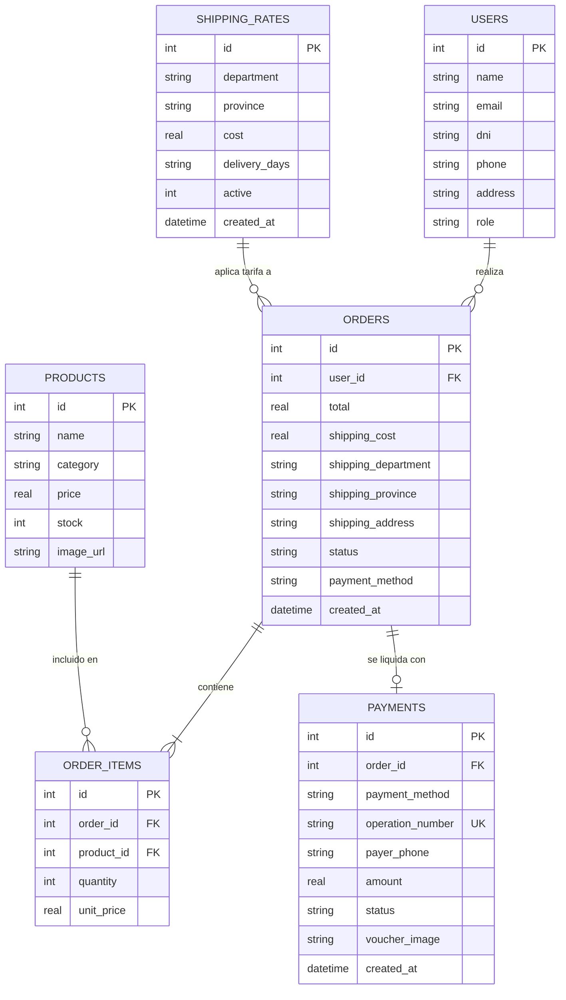
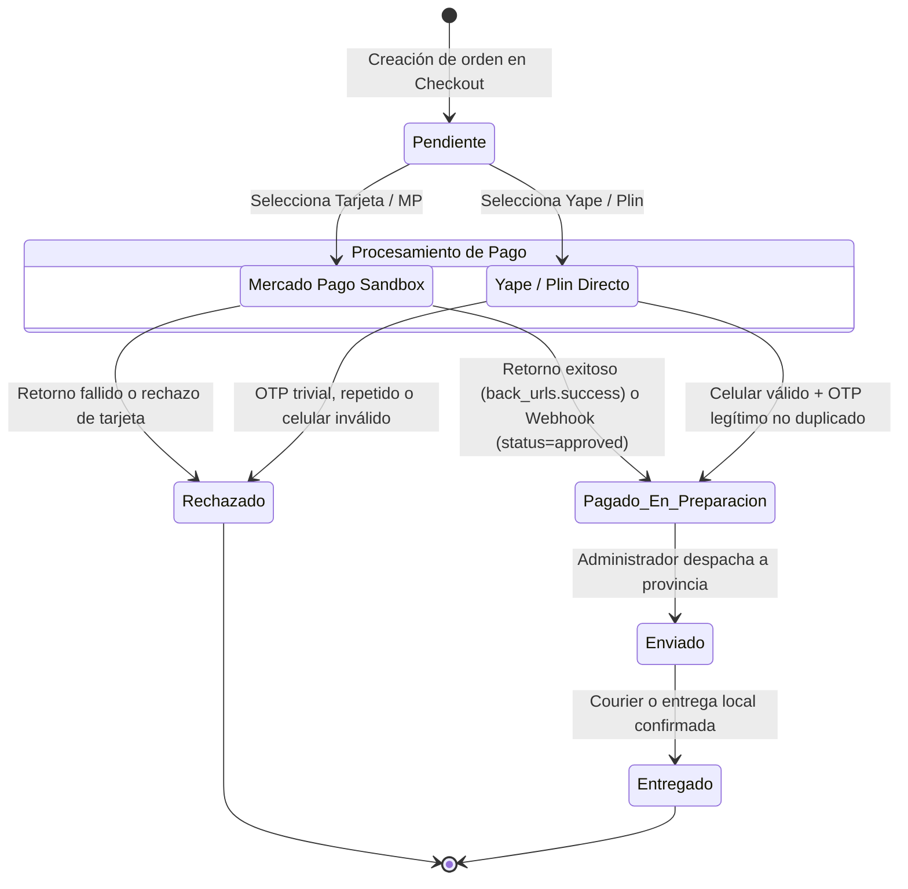

# Data Model: Módulo 007 - Mercado Pago (Tarjeta + Yape/Plin) y Tarifas de Envío por Provincia

**Feature Branch**: `007-mercadopago-yape-plin-envios` | **Spec**: [spec.md](./spec.md)

---

## 1. Esquema Relacional de Base de Datos (SQLite / Cloudflare D1)

### 1.1 Nueva Tabla: `shipping_rates`
Almacena las tarifas de flete según departamento y provincia para el despacho a nivel nacional.

```sql
CREATE TABLE IF NOT EXISTS shipping_rates (
  id INTEGER PRIMARY KEY AUTOINCREMENT,
  department TEXT NOT NULL,
  province TEXT NOT NULL,
  cost REAL NOT NULL,
  delivery_days TEXT NOT NULL,
  active INTEGER DEFAULT 1,
  created_at DATETIME DEFAULT CURRENT_TIMESTAMP
);

CREATE INDEX IF NOT EXISTS idx_shipping_rates_active ON shipping_rates(active);
CREATE INDEX IF NOT EXISTS idx_shipping_rates_prov ON shipping_rates(department, province);
```

### 1.2 Extensión de Tabla: `orders`
Se incorporan campos para registrar el destino y el costo de despacho de manera inmutable por orden.

```sql
-- Campos añadidos a orders (si no existen):
-- shipping_cost REAL DEFAULT 0.00
-- shipping_department TEXT DEFAULT ''
-- shipping_province TEXT DEFAULT ''
-- shipping_address TEXT DEFAULT ''
```

Estructura completa de `orders`:
```sql
CREATE TABLE IF NOT EXISTS orders (
  id INTEGER PRIMARY KEY AUTOINCREMENT,
  user_id INTEGER NOT NULL,
  total REAL NOT NULL,
  shipping_cost REAL DEFAULT 0.00,
  shipping_department TEXT DEFAULT '',
  shipping_province TEXT DEFAULT '',
  shipping_address TEXT DEFAULT '',
  status TEXT DEFAULT 'Pendiente',
  payment_method TEXT,
  created_at DATETIME DEFAULT CURRENT_TIMESTAMP,
  FOREIGN KEY (user_id) REFERENCES users(id)
);
```

### 1.3 Extensión de Tabla: `payments`
Se asegura el registro unívoco del número de operación / ID de transacción y el número telefónico del pagador.

```sql
CREATE TABLE IF NOT EXISTS payments (
  id INTEGER PRIMARY KEY AUTOINCREMENT,
  order_id INTEGER NOT NULL,
  payment_method TEXT NOT NULL,
  operation_number TEXT NOT NULL UNIQUE,
  payer_phone TEXT,
  amount REAL NOT NULL,
  status TEXT NOT NULL,
  voucher_image TEXT,
  created_at DATETIME DEFAULT CURRENT_TIMESTAMP,
  FOREIGN KEY (order_id) REFERENCES orders(id)
);

CREATE UNIQUE INDEX IF NOT EXISTS idx_payments_operation_number ON payments(operation_number);
```

---

## 2. Diagrama Entidad-Relación



---

## 3. Máquina de Estados del Pedido y Pago



---

## 4. Reglas de Validación de Dominio

| Campo / Atributo | Regla de Validación | Mensaje de Error en Fallo |
|---|---|---|
| `users.phone` / `payments.payer_phone` | Expresión regular `^9\d{8}$` (9 dígitos, comenzando con 9) | "El número de celular debe tener 9 dígitos y comenzar con 9" |
| `users.dni` | Expresión regular `^\d{8}$` (exactamente 8 dígitos numéricos) | "El DNI debe contener exactamente 8 dígitos numéricos" |
| `payments.operation_number` (Yape/Plin OTP) | 6 dígitos numéricos, no trivial (`000000`, `123456`, secuencias repetidas) y no existente en BD | "Código de aprobación inválido, trivial o previamente utilizado" |
| `payments.operation_number` (Mercado Pago) | ID numérico devuelto por API Mercado Pago (`payment_id`), único en BD | "Transacción de Mercado Pago ya procesada o inválida" |
| `shipping_rates.cost` | Valor numérico decimal $\ge 0.00$ en Soles (`S/`) | "El costo de envío debe ser un monto mayor o igual a cero" |
| `orders.shipping_province` | Debe coincidir con una tarifa activa o con "Otras Provincias (Nacional)" | "Debe seleccionar una provincia de envío válida" |

---

## 5. Datos Semilla Iniciales (`shipping_rates`)

| ID | Departamento | Provincia | Costo (`S/`) | Tiempo Estimado | Estado |
|---|---|---|---|---|---|
| 1 | Ayacucho | Huamanga (Entrega Local) | S/ 8.00 | 1 a 2 días hábiles | Activo (1) |
| 2 | Lima | Lima Metropolitana | S/ 12.00 | 2 a 3 días hábiles | Activo (1) |
| 3 | Nacional | Otras Provincias (Perú) | S/ 18.00 | 3 a 5 días hábiles | Activo (1) |
| 4 | Arequipa | Arequipa Ciudad | S/ 15.00 | 2 a 4 días hábiles | Activo (1) |
| 5 | La Libertad | Trujillo | S/ 15.00 | 2 a 4 días hábiles | Activo (1) |
